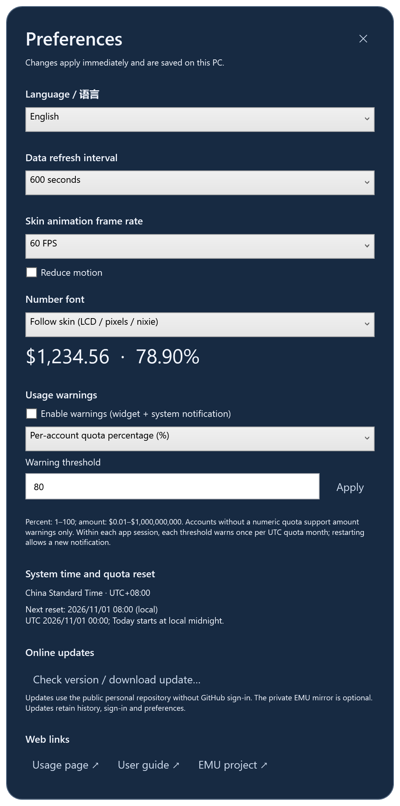

# Copilot Pulse

**把 Copilot 用量放在桌面上，让每一次增长都看得见。**

Copilot Pulse 是一个 Windows 桌面小组件，把 Microsoft 内部 Copilot Consumption 页面的本月用量、企业明细和历史趋势集中到一张可随时查看的卡片中。可以展开查看账户明细，也可以收成一个带动态皮肤的迷你数字框。

**v1.10.0 · Windows 10 1809+ / Windows 11 · x64 · 22 套内置皮肤 + 自定义背景**

[下载安装（个人仓库）](https://github.com/andylu1988/copilot-pulse/releases/latest) · [下载安装（EMU 仓库）](https://github.com/andylu_microsoft/copilot-pulse/releases/latest) · [详细使用指南](docs/USER-GUIDE.zh-CN.md) · [版本记录](CHANGELOG.md)


> 应用截图使用虚构账户、金额和历史，在隔离环境渲染。外观展示来自 v1.9.6；首次连接和 UTC 月份截图来自 v1.9.8。登录步骤中间栏是流程说明，不是 Microsoft 登录页截图。静态图展示动画的一帧。

## 它能做什么

| 功能 | 使用体验 |
| --- | --- |
| 自动刷新 | 默认每 60 秒读取页面，可选 15/30/60/120/300/600 秒，支持手动刷新和暂停。 |
| 用量总览 | 显示本月累计金额、企业明细、用量比例和 Monthly limit。 |
| 三种模式 | 完整模式看明细，紧凑模式看金额与趋势，迷你模式突出一个数字。 |
| 历史趋势 | 今天、24 小时、7 天、本月、指定月份；支持总用量与单个企业。 |
| 两种图表 | 累计折线看走势，变化柱状图看相邻采样变化，悬停查看详细读数。 |
| 区间净增长 | 完整与紧凑主卡片在小曲线下显示所选区间的总用量净增长，一起刷新。 |
| 换肤与动效 | 矩阵雨、液晶、赛博朋克、雷达、机甲、辉光管、电子墨水等，强度与速度可调。 |
| 自定义背景 | 导入本机 PNG/JPG/BMP，调整遮罩深浅和裁切焦点。 |
| 桌面常驻 | 拖动摆放、切换置顶、收起到托盘，隐藏后仍可继续采集。 |
| 在线更新 | 设置中检查正式版本、下载并校验安装包；默认从个人公开仓库更新，无需登录 GitHub。 |
| 数字字体 | 跟随皮肤或选择六种字体，完整 / 紧凑 / 迷你模式立即生效。 |
| 阈值进度 | 主金额下持续显示金额阈值进度或最高账户配额百分比，低于警告线也能看到。 |
| 本机历史 | 按月保存，重启后继续查看；升级与卸载保留历史和设置。 |

## 截图一览

### 从完整卡片到迷你数字框

<table>
<tr><th>完整：企业明细与总览</th><th>紧凑：金额与区间净增长</th></tr>
<tr><td></td><td valign="top"></td></tr>
</table>


### 看清今天的变化

“今天”从本机时间凌晨 00:00 到当前时间。曲线金额仍是采样时的本月累计读数；当天已记录的增长看“区间净变化”。示例最后读数 **$1,234.56**，今天净变化 **+$74.75**。


切换“单次变化”可以发现相邻连续读数在哪些时段增长较快。


## 下载与首次使用

1. 从 [最新版本](https://github.com/andylu1988/copilot-pulse/releases/latest) 下载 `CopilotPulse-Setup-1.10.0-x64.exe`。
2. 双击完成当前用户安装，可选择创建桌面快捷方式。默认位置为 `%LOCALAPPDATA%\Programs\CopilotPulse`。
3. 启动后组件尝试 Windows 主账户 SSO。如需登录，点击“连接 Microsoft 账户”，完成账户选择与验证。
4. 确认账户和月份，等待读取成功。点击“历史趋势”打开图表，点击“换肤”选择外观。


**步骤 1：点击连接。** 没有数据时点击“连接 Microsoft 账户 ↗”；也可打开菜单 →“Windows 账户登录 / 数据源”。

**步骤 2：完成官方验证。** 在组件打开的 Microsoft 登录与数据源窗口核对自己的 corp 账户，按组织提示完成 MFA。支持 SSO 且已同步时可跳过。

**步骤 3：确认数据进入组件。** Consumption 页面加载后会自动读取。主卡片显示“已同步”、总金额和企业明细后即完成；首次历史需积累至少两笔读数才能计算净增长。

安装通常无需管理员权限，自带 .NET 8 Desktop Runtime；缺少 WebView2 时运行微软官方引导程序，需要联网。安装包目前未签名，请遵循组织的软件安装策略。

**个人仓库公开，安装包可直接下载；EMU 镜像保持私有。** 每位使用者还需要具有 [内部 Consumption 页面](https://copilot.github.microsoft.com/?section=limits&tab=consumption) 的访问权限及相应网络环境。

## 按配额月份查看历史

配额按 **UTC 月份**划分，中国时区月初重置时间为 **1 日 08:00**。“今天”仍按本机自然日计算。点击“月份 ▾”选择已有记录的月份，替代原来的“全部”。主卡片净增长随所选月份一起刷新。


## 偏好设置（v1.9.9）

点击主卡片 **⋯ → 设置…**，或右键迷你框 / 托盘图标 → 设置，打开独立设置窗口。选择立即生效并保存；阈值输入后点击“应用”或按 Enter。

| 设置 | 可选内容 |
| --- | --- |
| 语言 | 简体中文 / English，主卡片、历史、换肤与菜单同步切换。 |
| 数据刷新 | 15、30、60、120、300、600 秒；默认 60 秒。 |
| 动画帧率 | 10、15、20、30、60 FPS；默认 20 FPS，也可减少动态效果。 |
| 用量警告 | 默认关闭；开启后显示卡片提示，并在成功同步时发出 Windows 通知。 |
| 警告阈值 | 各账户配额百分比 1–100%，或本月合计金额 $0.01–$1,000,000,000。 |
| 时间与链接 | 显示 Windows 系统时区、下次 UTC 月初重置对应的本机时间，提供用量网页和文档入口。 |

未提供具体数字限额的账户不计算百分比警告，可使用金额警告。本次运行中，每个账户在相同 UTC 配额月份和阈值下提醒一次；重启或修改阈值后可再次提醒。系统通知是否显示受 Windows 通知设置影响。

窗口背景、标题、普通文字和金额区域均可拖动；按钮、输入框、滑块和图表继续响应原有操作。Windows 更改时区后，应用会在一分钟内重新读取；“今天”按本机午夜，配额月份按 UTC 00:00。

<table><tr><th>中文</th><th>English</th></tr><tr><td></td><td></td></tr></table>

## 日常操作

| 想做什么 | 怎么操作 |
| --- | --- |
| 只显示数字 | 主窗口“迷你”，或设置 / 换肤中的“迷你数字”。 |
| 恢复大卡片 | 双击迷你框；右键可打开设置。 |
| 看当天增长 | 打开历史选择“今天”；主卡片净增长同步改为今天。 |
| 看单个企业 | 历史窗口左上角选择企业；主卡片净增长始终按总用量计算。 |
| 改刷新频率 | ⋯ → 设置 → 数据刷新频率；底部刷新按钮立即读取。 |
| 换外观 | 点击“换肤”，选择即生效，主卡片与历史窗口同步切换。 |
| 降低动画 | 开启“减少动态效果”，或在换肤界面关闭动态效果。 |
| 收起 / 退出 | 最小化收起到托盘，双击托盘图标恢复；托盘菜单退出。 |

安装、登录、趋势计算、全部皮肤、备份和问题处理见 [详细使用指南](docs/USER-GUIDE.zh-CN.md)。

## 数据来源、账户与隐私

这是非官方工具，读取内部页面展示的 GitHub Copilot 企业消费数据，单位为 **INTERNAL USD**。它不是通用的个人订阅统计工具，也不统计所有 AI 产品开销。**Monthly limit 是页面的使用上限，不代表个人预算；以源网站为核对依据。** 刷新频率不等于网站数据更新速度。

每位用户使用自己的账户。WebView2 尝试 Windows 主账户 SSO，但现有组件会话、多账户、MFA 或条件访问可能要求交互登录。组件不导入系统浏览器 Cookie，不读取或导出 PRT，也不保存用户输入的密码；WebView2 正常管理本机登录会话。

用量、历史、设置与自定义图片保存在：

```text
%USERPROFILE%\Documents\Codex\CopilotPulse-data
```

历史为 `history\YYYY-MM.jsonl`。这些文件**未额外加密**，可能包含企业名称、登录名、金额和时间。如果目录被系统同步或备份，文件也可能被同步或备份，请按组织要求管理。

应用不会主动把采集用量上传到额外服务；登录和读取页面仍需访问源站与认证服务。运行时不调用图像生成 API。安装包不含作者账户会话、真实用量、历史或 API Key。分享安装包即可，不要打包自己的数据目录或 WebView2 登录目录。

## 常见问题

| 现象 | 建议 |
| --- | --- |
| 未显示金额 | 在“Windows 账户登录 / 数据源”中完成登录，确认有源站权限。 |
| 浏览器正常，组件未登录 | 浏览器与 WebView2 会话分别管理，请在组件中登录。 |
| 刷新失败后金额不变 | 组件保留并标记上次成功读数，检查网络、会话与源页面后手动刷新。 |
| 今天没有曲线 | 今天尚无有效采样；无法回补应用未运行的历史。 |
| 净增长显示 `—` | 可能少于两个可比较读数、跨月重置或非零金额企业加入、移出；界面显示具体原因。零金额企业增减不影响计算。 |
| 重启看不到旧记录 | 先用“月份 ▾”选择旧月份，用“历史文件夹”检查记录和目录权限。 |
| 动画太强 | 降低强度 / 速度，或开启“减少动态效果”。 |

## 从源码构建

需要 Windows、.NET 8 SDK；解析器测试需要 Node.js。

```powershell
dotnet publish .\CopilotPulse.csproj -c Release -r win-x64 --self-contained true -o .\publish
node --test .\tests\parser.test.cjs
dotnet run --project .\tests\SsoPolicy\SsoPolicy.csproj
dotnet run --project .\tests\HistoryTests\HistoryTests.csproj -- .\work\history-tests
```

安装包需要 [Inno Setup](https://jrsoftware.org/isinfo.php)（已验证 6.7.3）与 [Microsoft WebView2 官方引导程序](https://go.microsoft.com/fwlink/p/?LinkId=2124703)。脚本检查引导程序的 Microsoft 签名及安装内容是否混入个人数据。

```powershell
.\installer\Build-Installer.ps1 `
  -CompilerPath 'C:\Program Files (x86)\Inno Setup 6\ISCC.exe' `
  -WebViewBootstrapper '.\MicrosoftEdgeWebview2Setup.exe' `
  -OutputDirectory '.\dist' `
  -BuildDirectory '.\work\installer-build'
```

`publish\CopilotPulse.exe --demo` 可预览外观，不覆盖真实缓存。本页截图另用隔离文档示例生成，见 [截图说明](docs/screenshots/README.md)。页面布局变化可能需要更新 `extract-consumption.js`。

## 参考与素材

介绍结构参考 [mcaps-microsoft/copilot-usage-monitor](https://github.com/mcaps-microsoft/copilot-usage-monitor) 的功能、截图、安装、使用与隐私说明组织方式。两个项目实现、功能和本机保存策略不同，该链接仅作介绍结构参考。

版本见 [CHANGELOG.md](CHANGELOG.md)，素材见 [矩阵背景](Assets/MATRIX-ART.md) 与 [当前应用图标](Assets/SELECTED-DESKTOP-ICON.md)。

## English

**Copilot Pulse puts your Copilot usage on the Windows desktop.** This unofficial widget reads the Microsoft internal Copilot Consumption page, with automatic refresh, enterprise details, local history, five time ranges, cumulative and change charts, three display modes, 22 built-in skins, and custom backgrounds.

Download the per-user x64 installer from [Releases](https://github.com/andylu1988/copilot-pulse/releases/latest). It includes the .NET runtime and installs WebView2 if needed. The installer is currently unsigned. The personal repository is public. Access to the internal source site is required. Windows SSO is attempted, but account selection, MFA, or organizational policy may require interactive sign-in. Every user signs in with their own account.

All screenshots use **synthetic accounts and usage**, rendered with actual v1.9.6 controls. History is stored **unencrypted locally** and is not proactively uploaded to an additional service by this application. Authentication and source-page requests still need network access. No author credentials, API keys or usage history are included in the installer.
### Preferences in v1.9.9

Open **⋯ → Settings…**, or right-click the mini widget / tray icon. Choose Chinese or English, a 15/30/60/120/300/600-second refresh interval, and 10/15/20/30/60 FPS. Settings apply immediately and persist locally. Thresholds require Apply or Enter.

Warnings are disabled by default. Choose a per-account numeric quota percentage (1–100%) or monthly total amount ($0.01–$1,000,000,000). Unknown quotas do not trigger percentage warnings. During each app session, each account/threshold warns once per UTC quota month; restarting permits another notification. Windows notification settings apply.

Windows timezone and the next UTC month reset in local time are displayed in Preferences. Today starts at local midnight; monthly quota periods start at UTC midnight. Drag ordinary text, amounts or background areas to move windows. Links open the usage page and guides in your default browser.
