# Copilot Pulse

**把 Copilot 用量放在桌面上，让每一次增长都看得见。**

Windows 桌面小组件，读取 Microsoft 内部 Copilot Consumption 页面，显示月度用量、历史趋势和单次任务期间的观测增量。

**v1.13.0 · Windows 10 1809+ / Windows 11 · x64 · 22 套皮肤**

[下载安装](https://github.com/andylu1988/copilot-pulse/releases/latest) · [EMU 仓库](https://github.com/andylu_microsoft/copilot-pulse/releases/latest) · [使用指南](docs/USER-GUIDE.zh-CN.md) · [更新介绍](docs/RELEASE-v1.13.0.md) · [English](#english)

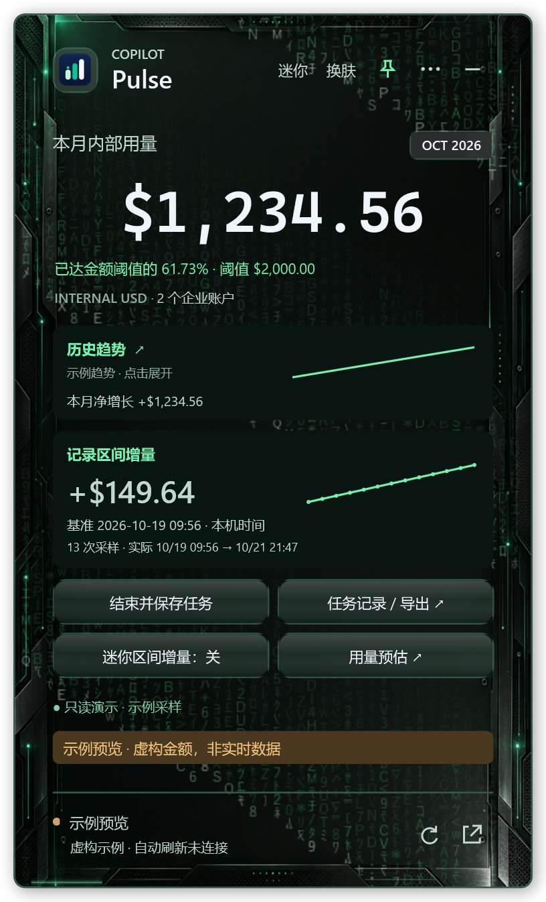

> 本页新版截图由实际应用在隔离环境中渲染，账户、任务和金额均为虚构示例；“示例 / 只读演示”是截图环境标记，正式菜单已移除演示入口。静态图片显示动画的一帧。不同图中的预估和警告可使用独立场景。

## v1.13.0 的变化

| 功能 | 可以怎么用 |
| --- | --- |
| 命名任务计量 | 给记录区间加任务备注，保存起止时间、增量、采样记录，观察一次修复、代码审查或方案准备期间的花费。 |
| 采样健康 | 查看最近成功时间、失败、重试与估计缺失采样，区分真实用量变化与数据延迟。 |
| 任务对比与导出 | 并排比较两个任务的增量、持续时间、单次最大变化和采样数，导出 PNG、CSV / JSON 或复制摘要。 |
| 用量预估 | 优先显示预计月末累计量、是否会在重置前耗尽，再看进度与统计依据。 |
| 提醒升级 | 持久化冷却、免打扰、完全静默、重置前提醒、采样中断与恢复提醒。 |
| 快捷操作 | 可选全局快捷键、托盘任务操作、暂停采样、悬停用量提示、多显示器窗口位置恢复。 |
| 图表交互 | 悬停、固定采样提示、滚轮缩放、框选时间、重置视图，以及午夜、UTC 月重置和异常变化标记。 |
| 连接诊断 | 检查时区、浏览器会话、登录、采样与存储，导出不含账户和金额的诊断报告。 |
| 外观整理 | 四个等大毛玻璃按钮、清晰圆角图标、宽版分类设置；换肤合并至设置，主界面仍可直接进入。 |
| 切换性能 | 矩阵动画合成为单张帧图，复用毛玻璃背景，减少打开与关闭窗口时的渲染等待。 |

## 用记录区间观察单次任务花费

1. 点击 **开始任务计量**，填写“修复登录 Bug”等任务备注。
2. **等待第一个成功采样**，它是零基线；然后开始工作。
3. 观察主界面的“记录区间增量”，点击卡片查看曲线和采样健康。
4. 结束工作后等待源页面更新，再点击 **结束并保存**。
5. 在 **任务记录 / 导出** 回看、重命名、复制摘要或导出；在 **用量预估 → 区间对比** 比较两次任务。

这是页面读数的观测增量，不是精确任务账单。源页面延迟和同时运行的工作会影响结果；缺失采样不会被伪造补齐。任务和记录重启后保留。

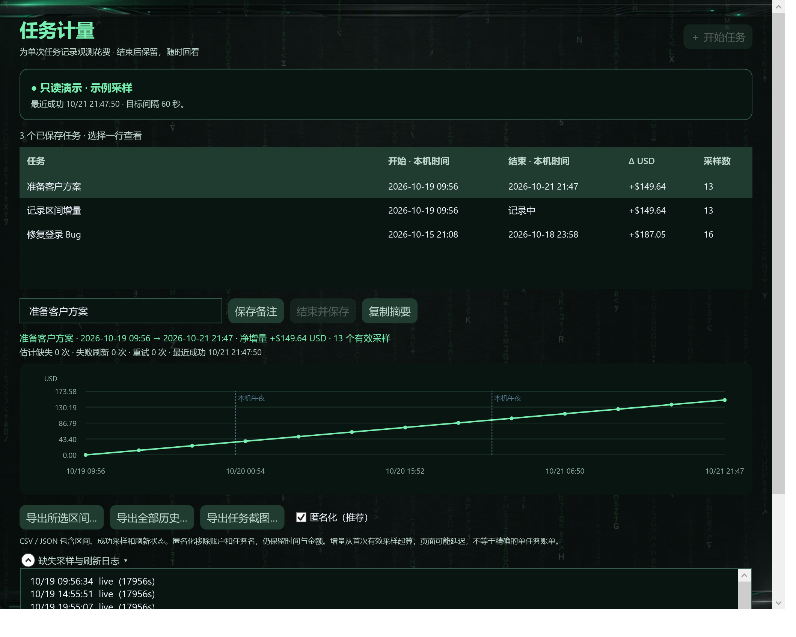

**迷你显示任务增量是手动选项**：点击主界面“迷你区间增量”开启，再切换迷你模式。默认仍显示月度累计；没有有效任务读数时显示 `—`。从迷你恢复时，记住之前的紧凑 / 完整模式。

| 月度累计 | 当前任务增量 |
| --- | --- |
| 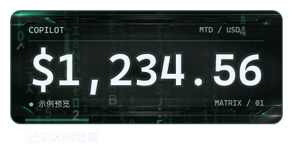 | 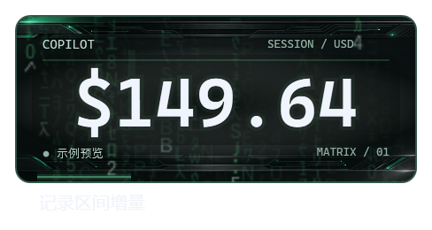 |

[任务计量与数据口径](docs/task-measurements.md)

## 用量预估与区间对比

按近一小时、过去 24 小时或本月记录外推，突出 **预计月末累计量** 和 **按此速度是否会耗尽**。进度条下方说明样本覆盖、速度和预计重置时间。

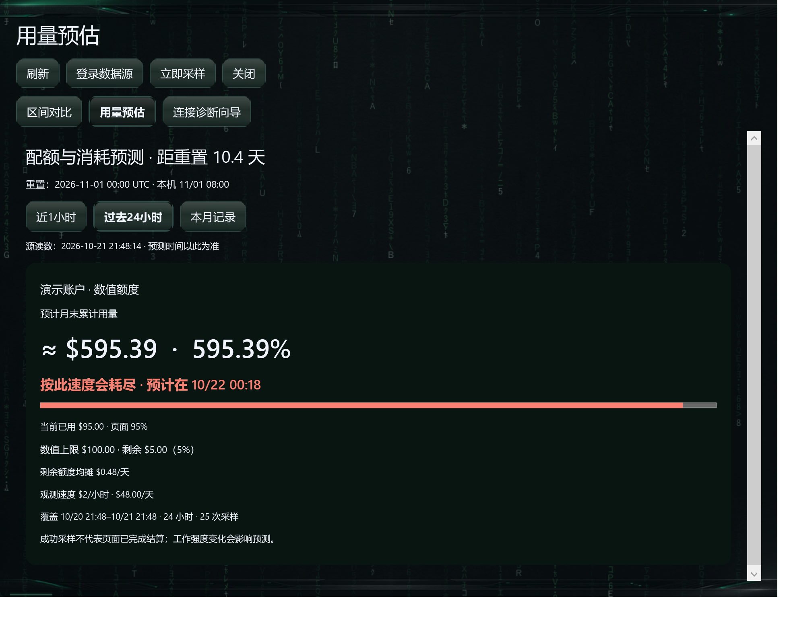

配额以 **UTC 月初 00:00** 重置，界面换算为 Windows 当前系统时区。“今天”按本机午夜计算；“本月 / 指定月份”按 UTC 配额月份计算。至少需要两个可比较读数且间隔不少于一分钟。页面只有 `Standard` 而没有数值上限时，只按页面百分比做明确标注的近似外推，不假定固定金额上限；百分比低于 0.1% 时不外推。读数过旧、来自上月或未来时暂停预测。预测随工作负载变化，不代表实际结算。

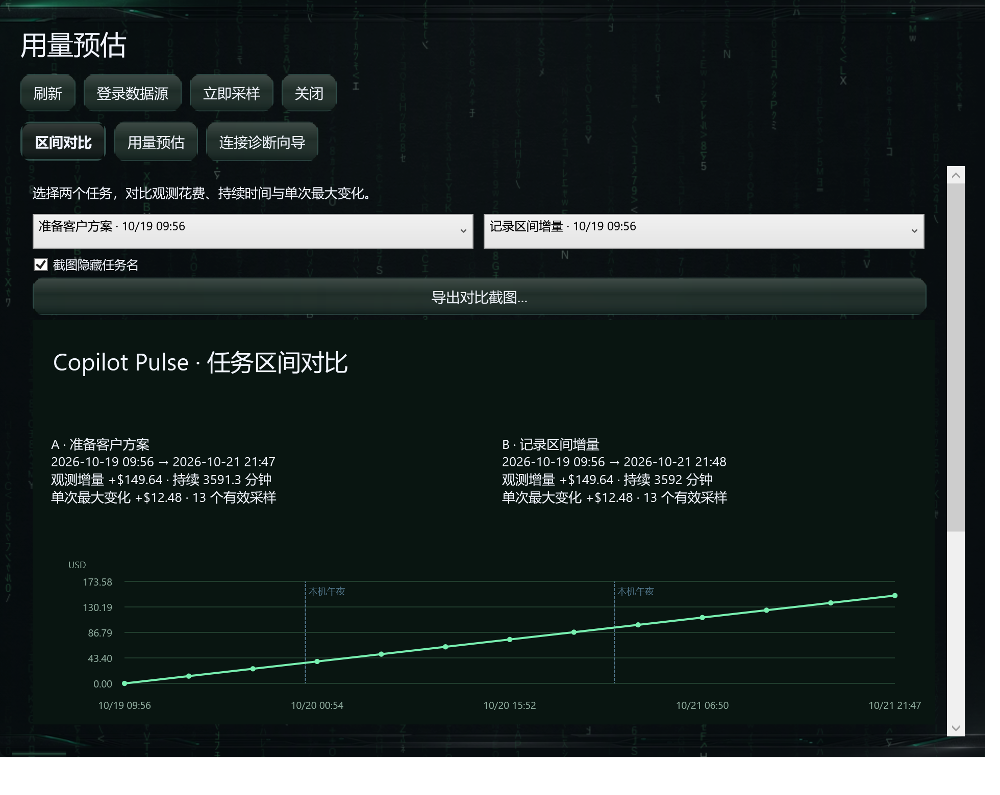

## 历史趋势与阈值警告

支持今天、24 小时、7 天、本月及已有月份；查看累计折线或相邻变化。悬停查看时间和金额，点击固定提示；滚轮缩放，拖动框选，双击或右键恢复。自动刷新保留缩放范围。历史与记录窗口保持实色背景，便于读图。

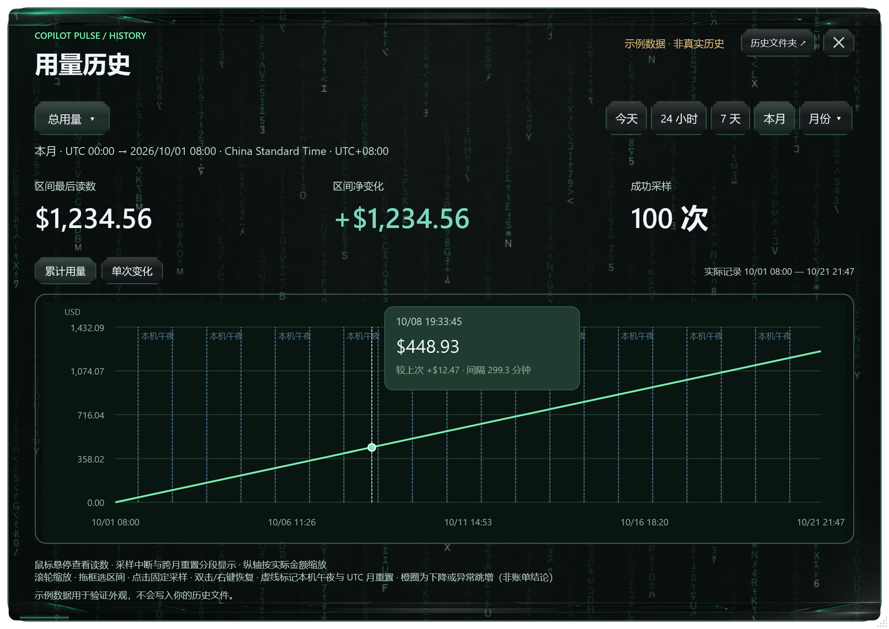

金额阈值进度持续显示，即使未触发警告也能查看。示例月度累计 **$1,234.56**，阈值 **$2,000** 时显示 **61.73%**；阈值改为 **$1,000** 时显示 **123.46%**，超出 **$234.56**。阈值是用户设置的提醒线，不会改变源站配额。

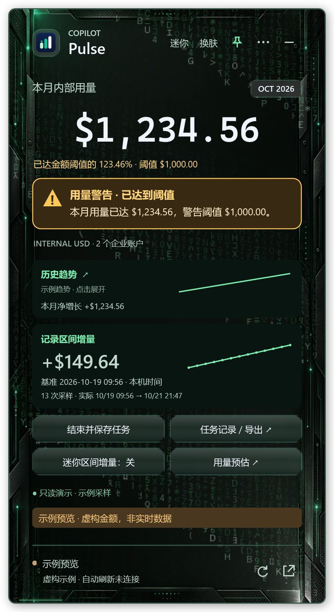

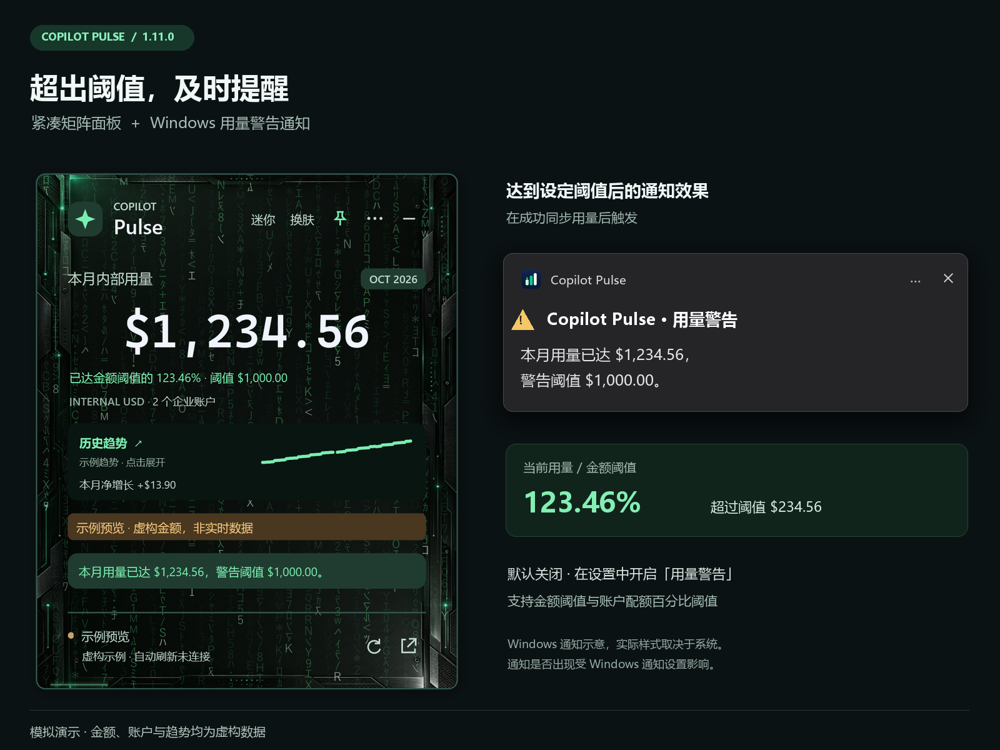

上方系统通知图为早期版本的展示示意；实际呈现受 Windows 通知与免打扰设置影响。应用内警告在静音时仍显示。设置中可配置一次性 / 每小时 / 每四小时 / 每日提醒、安静时段、即将重置和采样中断 / 恢复通知。

## 设置与换肤

设置改为更宽的分类布局：常规、外观、皮肤、计量、警告、通知、快捷操作和更新。右上角关闭按钮与底部完成操作保持固定。主界面“换肤”直接进入同一设置窗口的皮肤页。支持矩阵、液晶、赛博朋克等皮肤、自定义背景、数字字体、动画强度与帧率，以及中文 / English。

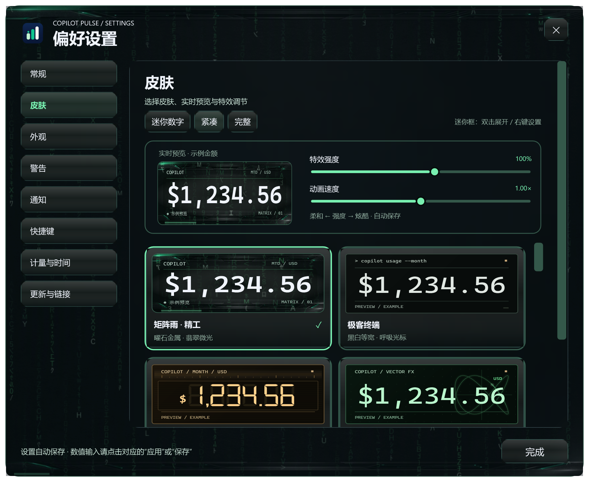

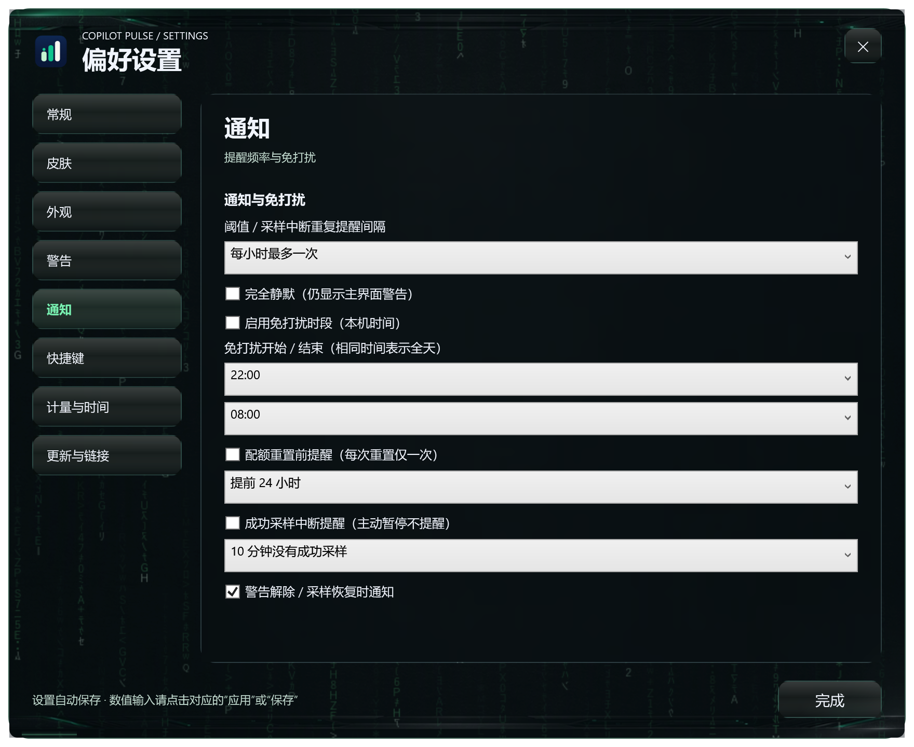

## 安装、登录与诊断

1. 从 [Releases](https://github.com/andylu1988/copilot-pulse/releases/latest) 下载 `CopilotPulse-Setup-1.13.0-x64.exe`，按向导安装到当前用户。
2. 点击 **连接 Microsoft 账户**；在官方登录窗口选择自己的公司账户，按组织要求完成验证。
3. 等待 Consumption 页面加载和第一次成功同步；有至少两笔有效读数后才能计算增长。
4. 遇到数据延迟，在菜单打开 **连接诊断**，检查登录与采样状态，必要时“立即采样”。

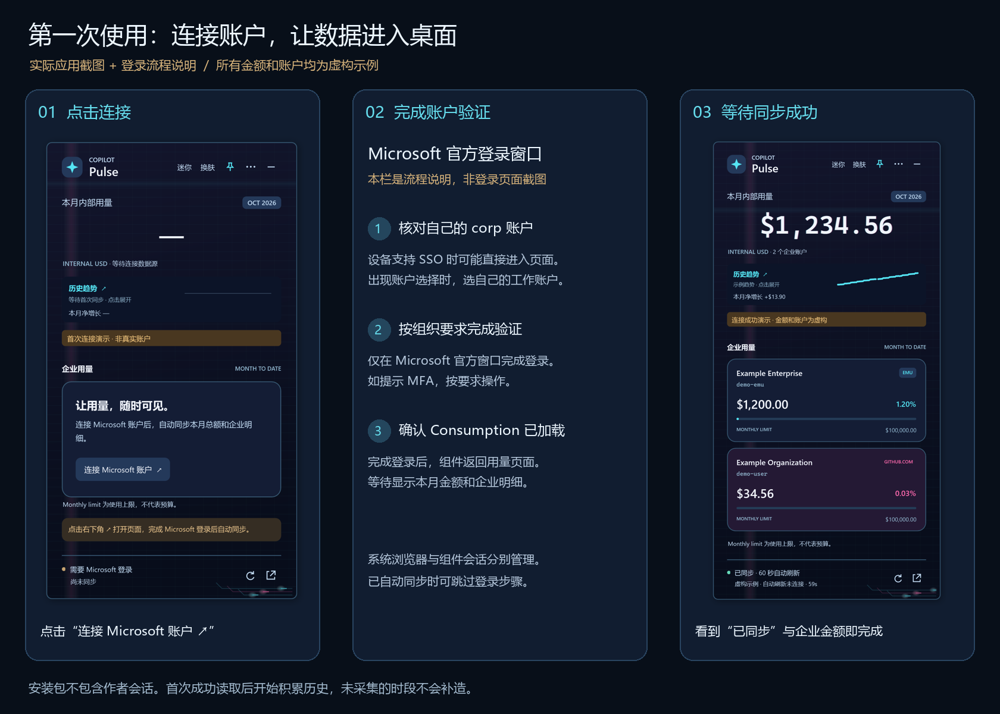

上图中间栏为验证流程说明，并非 Microsoft 登录页截图。WebView2 尝试 Windows 主账户 SSO，但不保证直接复用系统浏览器会话或 PRT。每位用户使用自己的身份与站点权限，安装包不包含作者账户、会话或密钥。安装器目前没有发布者代码签名；请核对发布来源与 SHA-256。

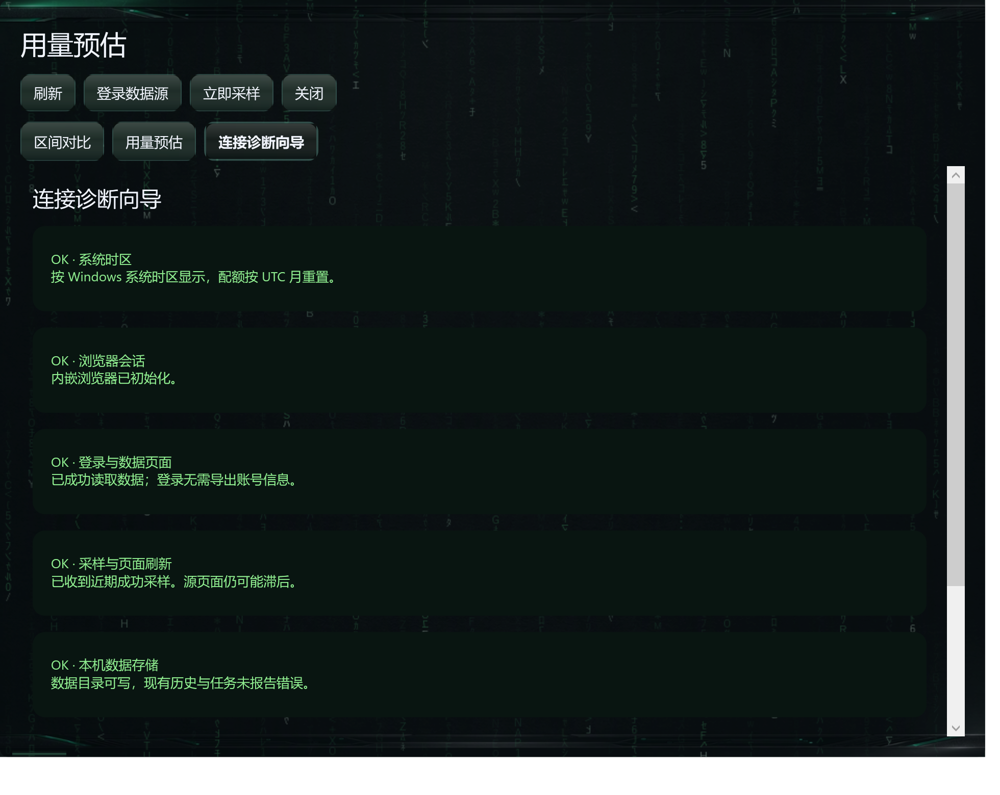

## 数据、更新与开发

设置、历史、任务与采样日志保存在本机应用数据目录。当前默认位置为 `%USERPROFILE%\Documents\Codex\CopilotPulse-data`，历史按 UTC 月份分文件；旧安装会迁移数据。升级 / 卸载保留数据。文件未加密，备份前先正常退出应用。

CSV / JSON 与任务图片默认匿名化，移除账户信息和任务名称，**仍包含时间、金额和任务 ID**；分享前检查。匿名诊断报告另有严格字段限制，不含账户、金额、令牌、Cookie、完整 URL 或网页正文。

每小时检查公开仓库正式版本；发现新版本后，“迷你”左侧显示提醒。一键下载、SHA-256 校验、安装并重启客户端，Windows 无需重启。新版本提醒未打开满 48 小时后自动安装；打开提醒会取消该次无人值守倒计时。“关于”显示本地及云端版本。

开发需要 .NET 8 SDK、Windows 和 WebView2 Runtime：

```powershell
dotnet build -c Release
dotnet run --project tests/HistoryTests/HistoryTests.csproj -c Release -- ..\test-results
```

本次本机验证包含 224 项自动检查、隔离安装 / 自动更新验证，以及两轮各 48 次矩阵窗口切换，最大 UI 调度间隔约 1.2 秒和 1.0 秒。这是本机测量结果，不保证所有设备相同。

本工具为非官方项目，数据以源站为准。产品介绍参考 [copilot-usage-monitor](https://github.com/mcaps-microsoft/copilot-usage-monitor)；矩阵美术来源见 [素材说明](Assets/MATRIX-ART.md)。

## English

**Copilot usage, visible on your Windows desktop.** Copilot Pulse reads the internal Microsoft Copilot Consumption page and shows monthly totals, history and observed usage during a named task. [Download](https://github.com/andylu1988/copilot-pulse/releases/latest) · [Task guide](docs/task-measurements.md) · [Forecast and operations](docs/usage-insights.md).

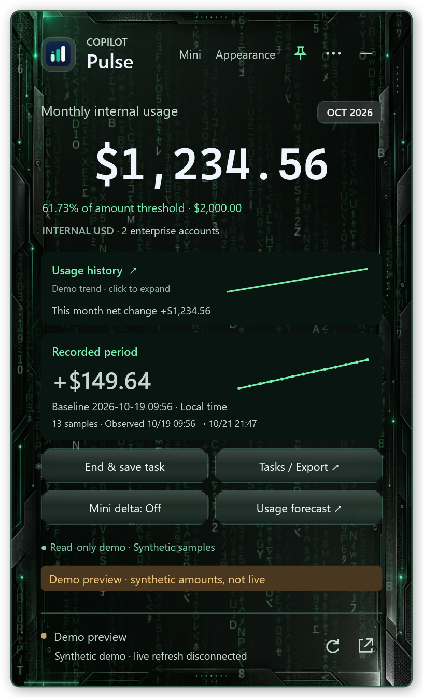

Screenshots use fictional accounts, amounts and tasks in an isolated review environment. Demo labels identify screenshot data; the public demo menu has been removed. Forecast and warning images may use separate scenarios.

### Measure and compare tasks

Choose **Start task measurement**, enter a note, and wait for the first successful sample before starting work. Watch the recorded-period delta, then wait for source data to catch up and choose **Finish and save**. **Task records / Export** keeps names, timestamps, deltas, samples and sampling health across restarts. Compare two saved tasks under **Usage forecast → Task comparison**, export PNG / CSV / JSON, or copy a summary.

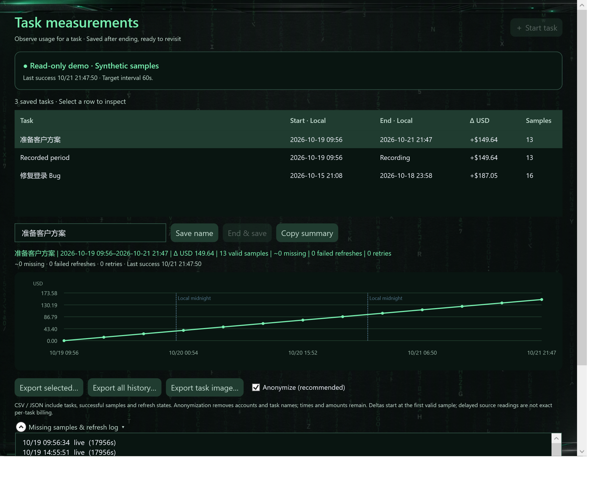

This helps observe the cost of a single task, but is not an exact task bill. Source lag and concurrent work affect attribution. Missing samples are not invented. Mini task delta is an explicit main-panel option; monthly total remains the default. Returning from mini restores the previous compact or full layout.

### Forecasts and interactive history

Forecasts emphasize **projected month-end usage**, **whether quota may run out before reset**, then progress and sampling statistics. Select the last hour, last 24 hours or observed current month as the rate basis. Two comparable samples spanning at least one minute are required. For Standard without a numeric cap, explicitly approximate percentage projections use the page ratio; percentages below 0.1% are not extrapolated. Stale, previous-month or future readings pause predictions.

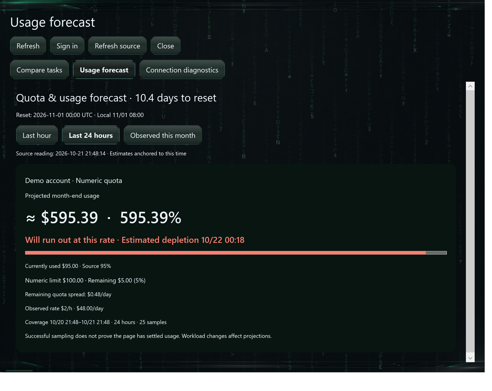

Quota resets at **00:00 UTC on the first of the month**, displayed in the Windows timezone. Today starts at local midnight; quota-month ranges follow UTC. Hover or pin chart points, wheel to zoom, drag to select and double-click or right-click to reset. Refresh retains zoom. Charts mark local midnight, UTC reset and unusual changes. History windows retain opaque backgrounds for readability.

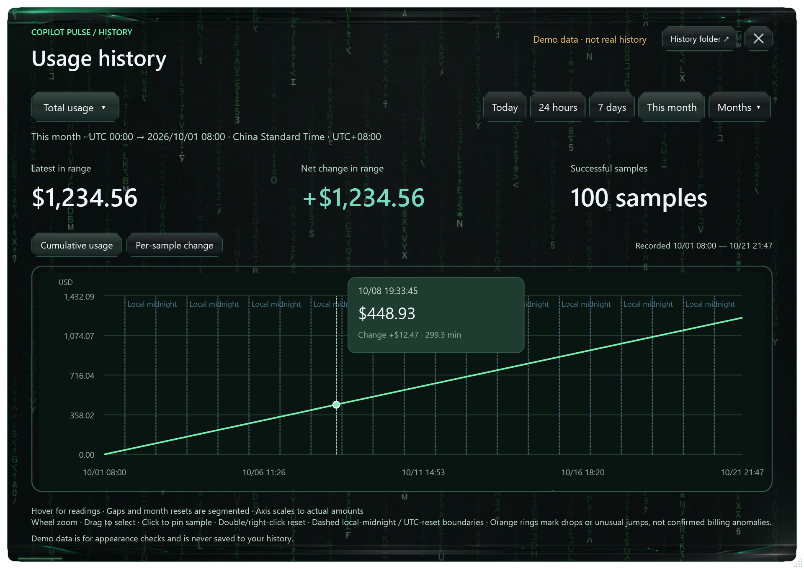

### Thresholds and notifications

Threshold progress is always visible. With fictional usage of **$1,234.56**, a **$2,000** threshold shows **61.73%**; a **$1,000** threshold shows **123.46%**, exceeding it by **$234.56**. A personal alert threshold does not change the service quota.

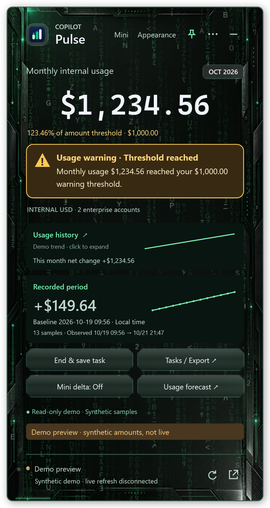

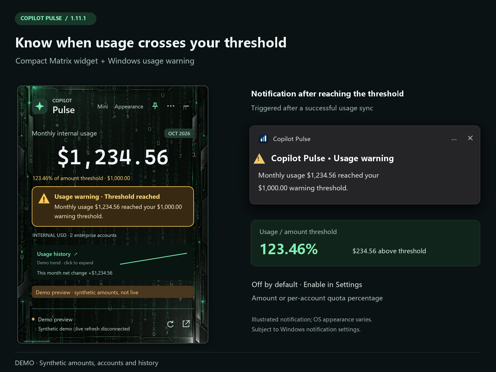

The notification illustration is from an earlier version; actual delivery depends on Windows settings. Widget warnings remain visible when notifications are muted. Configure persistent cooldowns, local quiet hours, silent mode, reset reminders, sampling interruptions and recovery messages.

### Settings, shortcuts and connection

A wider categorized Settings window includes the skin gallery, language, digit fonts, animation frame rate, warnings, notifications, shortcuts and updates. Close and Done stay visible; the main Skin shortcut opens that settings page directly. Four equally sized glass buttons and a crisp rounded app badge unify the main panel. Matrix animation now uses one composited frame and shared glass surfaces to reduce rendering stalls.

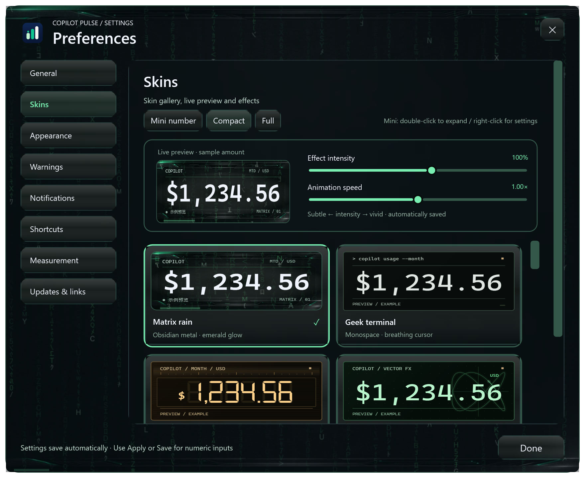

Opt-in global shortcuts: **Ctrl+Alt+T** task start/finish, **Ctrl+Alt+M** mini, **Ctrl+Alt+R** refresh and **Ctrl+Alt+H** recent task. Tray actions support sampling pause/resume and show usage on hover. Window placement handles multiple monitors. Connection diagnostics checks timezone, session, login, sampling, storage and shortcut registration.

Install the x64 setup, click **Connect Microsoft account**, authenticate with your own corporate account and wait for synchronization. WebView2 attempts Windows-account SSO; sharing a system-browser session or PRT is not guaranteed. Installation does not grant access to the internal source. No author credentials are distributed. The installer is currently unsigned; check its origin and SHA-256.

Local unencrypted files retain settings, history, tasks and refresh events across upgrades / uninstall. Default: `%USERPROFILE%\Documents\Codex\CopilotPulse-data`. Anonymous exports remove account details and task names but retain timestamps, amounts and task IDs; review before sharing. Diagnostic exports exclude accounts, amounts, tokens, cookies, full URLs and page bodies.

Updates are checked hourly using public GitHub releases. The main-panel badge offers download, checksum verification, installation and app restart in one action. Unopened reminders trigger automatic installation after 48 hours; opening a reminder cancels that unattended countdown. Windows itself does not restart. About shows local and latest versions.

This is an unofficial tool. Source data is authoritative; observations and forecasts are not settled bills. See [changes](CHANGELOG.md) and [release notes](docs/RELEASE-v1.13.0.md).
