# Copilot Pulse

**把 Copilot 用量放在桌面上，让每一次增长都看得见。**

Windows 桌面小组件，读取 Microsoft 内部 Copilot Consumption 页面，显示月度 Overall、历史趋势和单次任务期间的观测增量。

**v1.13.1 · Windows 10 1809+ / Windows 11 · x64 · 22 套皮肤**

[下载安装](https://github.com/andylu1988/copilot-pulse/releases/latest) · [EMU 仓库](https://github.com/andylu_microsoft/copilot-pulse/releases/latest) · [使用指南](docs/USER-GUIDE.zh-CN.md) · [English guide](docs/USER-GUIDE.en.md) · [本版介绍](docs/RELEASE-v1.13.1.md) · [English](#english)

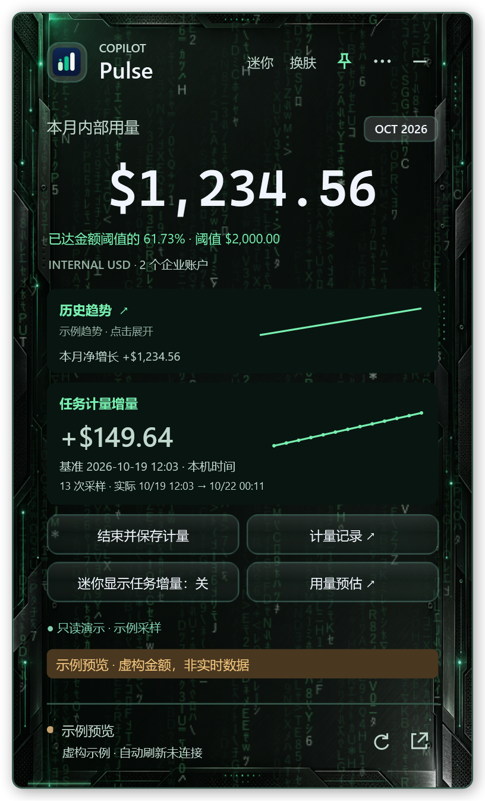

> 新版截图均由实际应用在隔离环境中渲染，账户、金额、任务和日期均为虚构示例。“示例 / 只读演示”是截图环境标记，正式菜单没有演示入口。静态图片为动画的一帧，不同预估和警告图可能使用独立场景。

## v1.13.1：任务计量与界面整理

本次更新合并 v1.13.0 新增的任务计量、采样健康、导出、提醒、快捷操作和图表交互，并按实际使用反馈整理界面与计算口径。

| 功能 | 使用方式 |
| --- | --- |
| 任务计量 | 输入任务备注，记录单次 Bug 修复、代码审查或方案准备期间的观测增量。 |
| 计量记录 | 保存任务名、起止时间、增量和采样次数；查看曲线、重命名、复制摘要，导出 CSV / JSON / PNG。 |
| 采样健康 | 显示最近成功时间、失败、重试与估计缺失采样，帮助识别数据延迟。 |
| 用量预估 | 仅按 Overall 本月累计和 UTC 月份已过时间估算月末累计，优先读取配置的金额提醒阈值。 |
| 提醒 | 持久化冷却、免打扰、完全静默、重置前提醒、采样中断与恢复提醒。 |
| 快捷操作 | 可选全局快捷键、托盘操作与悬停用量、多显示器位置恢复。 |
| 交互图表 | 悬停、固定提示、缩放、框选、午夜 / UTC 重置 / 异常变化标记。 |
| 统一外观 | 2×2 等大玻璃按钮、圆角高清图标、分类设置与皮肤页；关于、更新和任务命名窗口同步皮肤。 |

### 用任务计量观察一次工作的花费

1. 点击 **开始任务计量**，填写任务备注。
2. **等待首个成功采样建立零基线，再开始工作**。
3. 在 **任务计量增量** 查看本次增长，点击卡片查看独立曲线。
4. 结束工作后等待源页面读数更新，点击 **结束并保存计量**。
5. 在 **计量记录** 查看采样健康、复制摘要或导出数据与图片。

这是页面读数的观测增量，包含源页面延迟与同期并行用量，不能当成精确单任务账单。缺失采样不补造；任务、历史和采样日志在重启后保留。


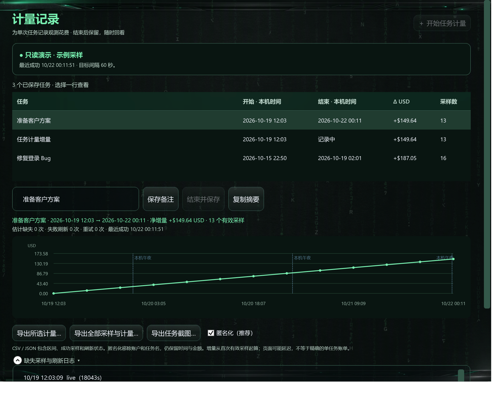

**迷你显示任务增量是手动选项**。开始任务计量后，该按钮才可用；未开启任务时禁用。结束任务后立即恢复月度 Overall 显示，不会留下横线。任务正在进行但尚无有效采样时，明确显示等待状态。从迷你恢复时保留之前的紧凑 / 完整模式。

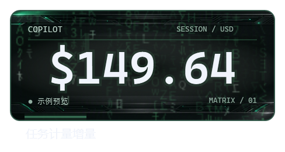

### 精简后的用量预估

窗口依次突出 **预计月末累计量 → 按此速度是否会达到目标 → 进度条 → 小字统计依据**。只看 Overall，不再分账户、选择不同速度或读取历史文件；移除了区间对比及连接操作。诊断改为主界面 **⋯ → 连接诊断** 的独立窗口。

计算：**本月累计 ÷ UTC 配额月已过时长 × 当月总时长**。配置金额提醒阈值时，优先按该阈值判断是否预计超出；例如 $2,000。提醒阈值是个人目标，不会改变源站配额，因此界面明确称“达到提醒阈值”。没有金额阈值时，仅在源站提供可合计的完整数值上限时判断配额耗尽；百分比阈值缺少金额上限时会说明无法换算。静音通知不会清除预估目标。

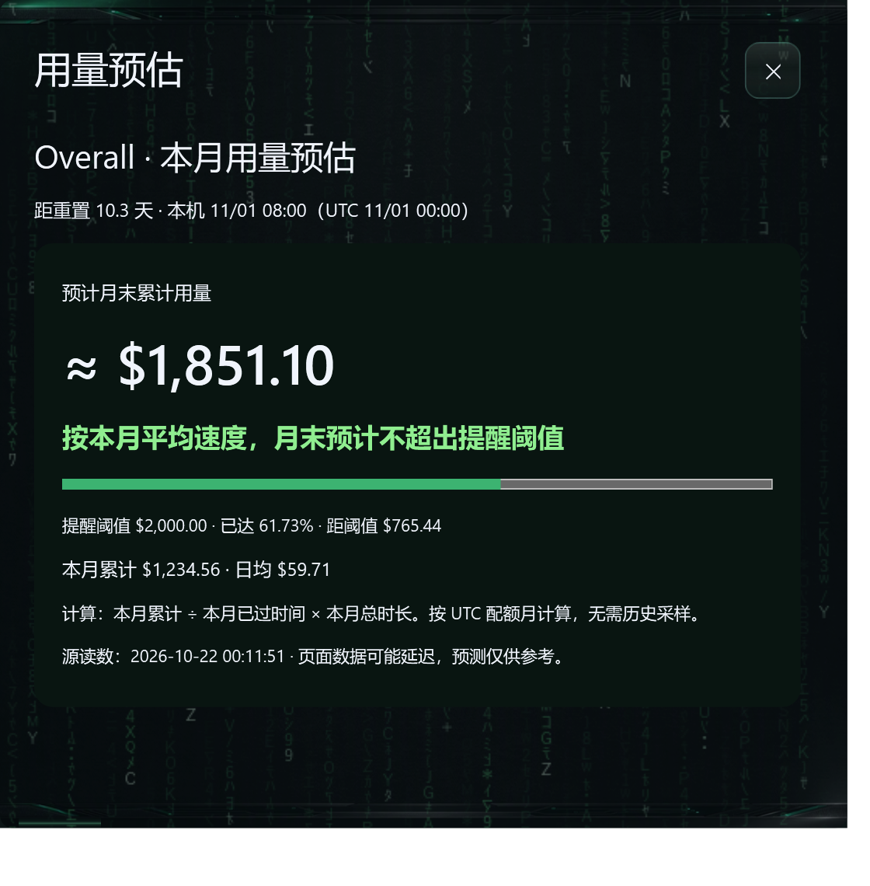

源读数过旧、属于上月或未来时暂停预估；按源读数时间计算，重绘不会推迟预计达到目标的时间。预估会随后续工作强度变化，仅供参考。

### 趋势、时区与警告

“今天”从 Windows 本机午夜开始；24 小时、7 天是滚动区间；“本月 / 指定月份”按 UTC 配额月划分，重置为 **每月 1 日 UTC 00:00**，同时换算系统时区显示。净增长只计算可比较读数的变化，不把缺失起点假定为零。

图表支持悬停读值、点击固定、滚轮缩放、拖动框选、双击或右键重置。刷新保留缩放。历史和计量曲线窗口保持实色背景，便于读图。

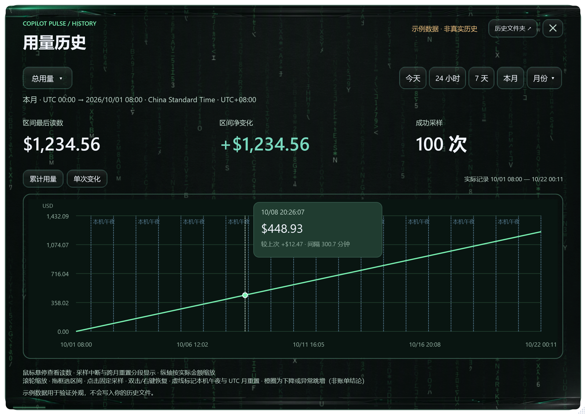

金额阈值进度持续显示。虚构示例用量 $1,234.56、阈值 $2,000 时为 61.73%；阈值改为 $1,000 时为 123.46%，超出 $234.56。应用内警告在静音时仍显示。

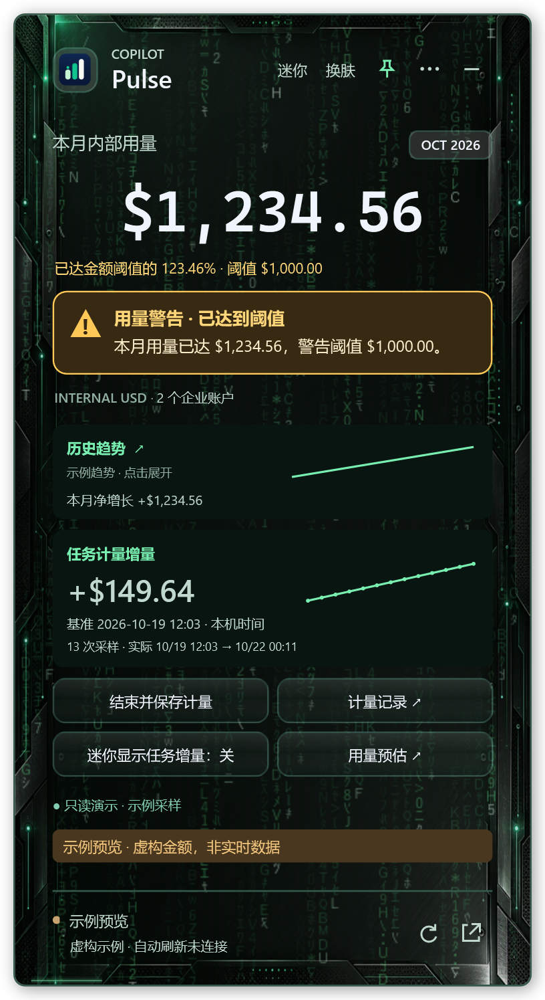

系统通知的实际外观和送达受 Windows 通知与免打扰设置影响。通知支持一次 / 每小时 / 每四小时 / 每日冷却、安静时段、重置前提醒、中断和恢复通知。主动暂停不触发采样中断提醒。

### 设置、皮肤和工具窗口

设置采用较宽的分类布局，关闭和完成操作固定显示；**换肤** 直接进入设置的皮肤页。支持中文 / English、刷新频率、数字字体、动画强度 / 帧率、自定义背景和提醒设置。正式菜单移除只读演示入口，文档截图仍通过隔离测试入口生成。

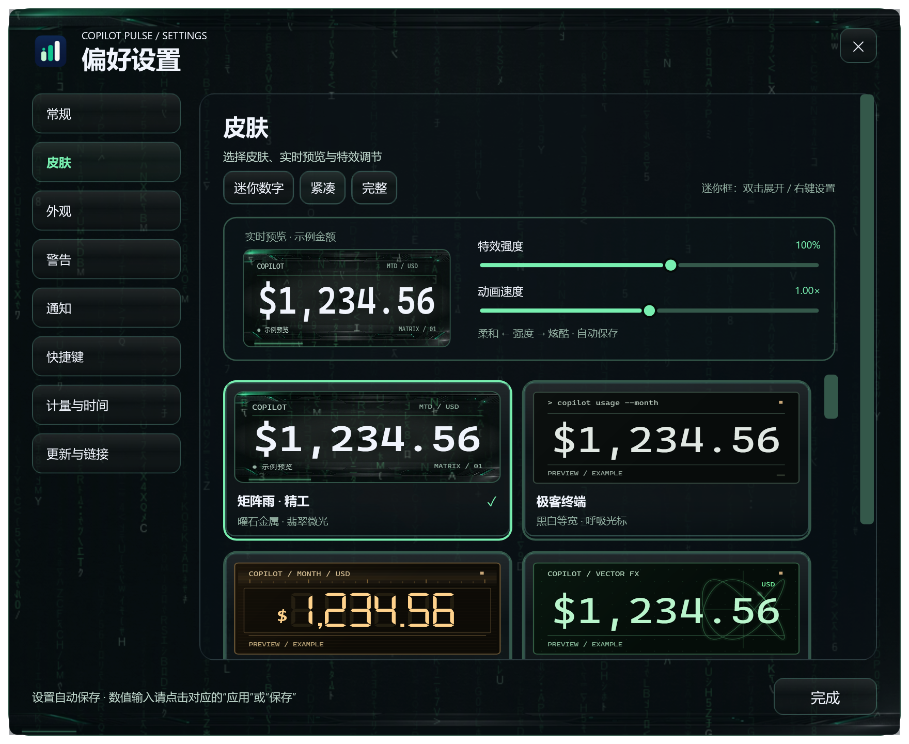

关于、在线更新、任务命名和计量记录使用当前皮肤与玻璃按钮；计量表头、圆角输入框和滚动条同步统一；更新仓库选择框适配深色。矩阵动画使用单张合成帧和缓存玻璃背景，避免在布局和绘制时反复截图。

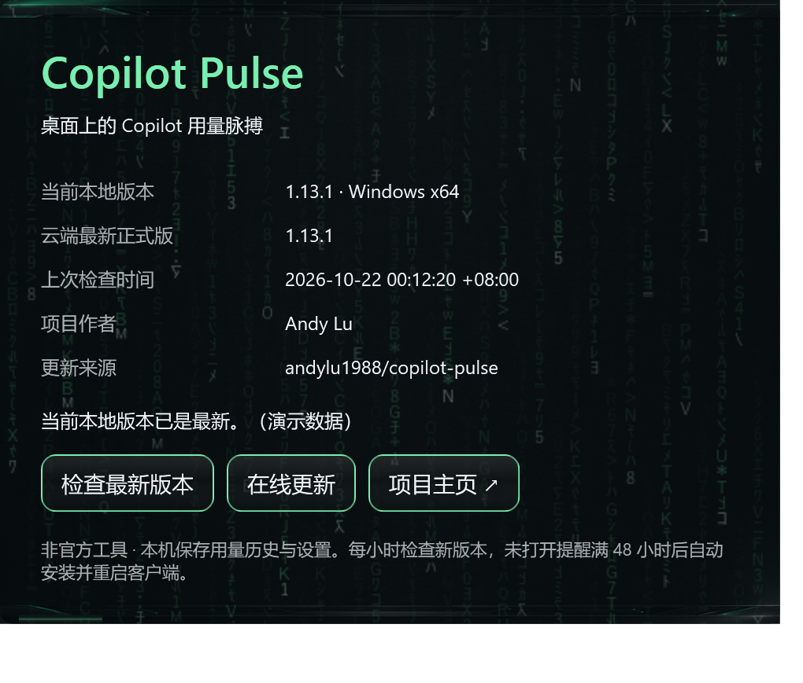

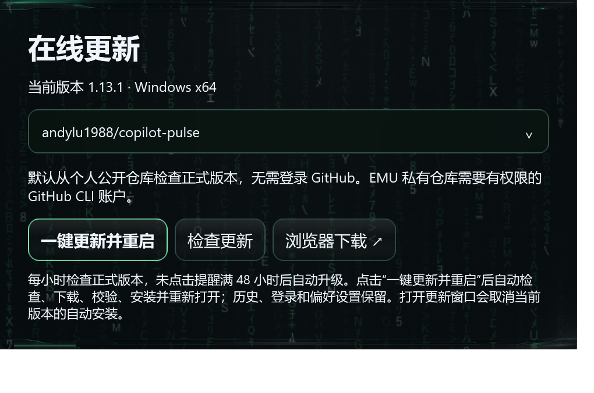

可选全局快捷键：Ctrl+Alt+T 开始 / 结束任务、Ctrl+Alt+M 迷你、Ctrl+Alt+R 刷新、Ctrl+Alt+H 最近任务；默认关闭，冲突会提示。托盘可暂停 / 恢复采样，悬停查看用量。窗口保存多显示器位置，并可从空白区域拖动。

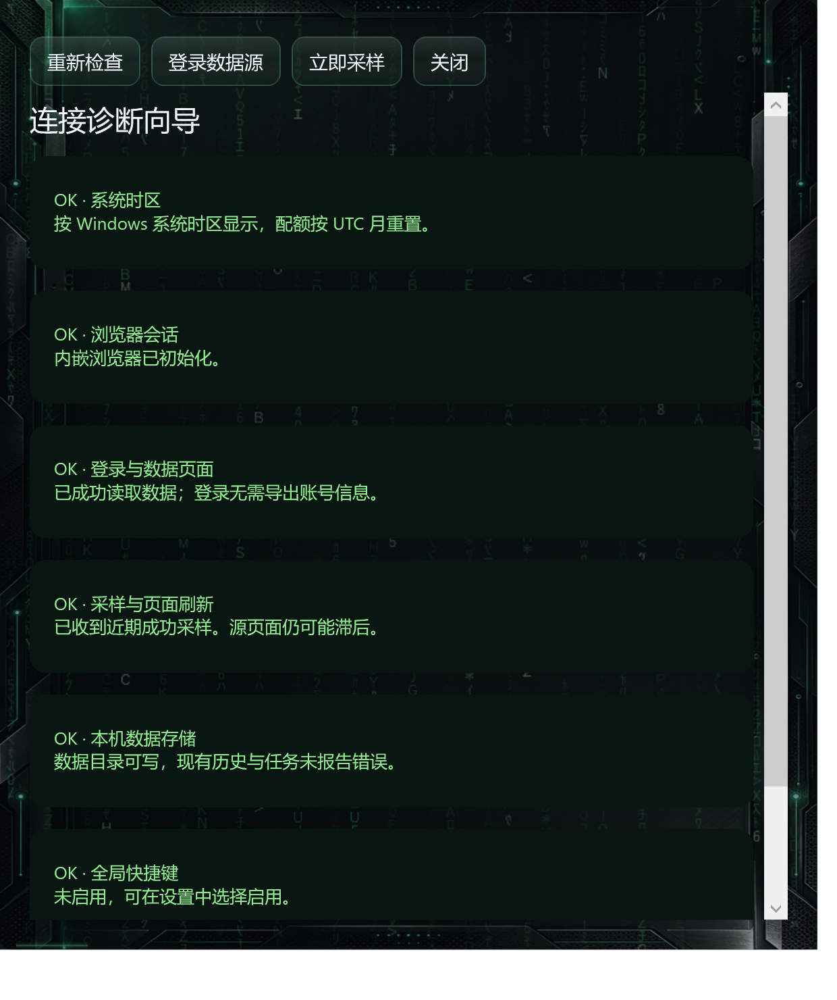

## 安装、连接、数据与更新

1. 下载 [最新版安装包](https://github.com/andylu1988/copilot-pulse/releases/latest)中的 `CopilotPulse-Setup-1.13.1-x64.exe`，按当前用户安装。
2. 点击 **连接 Microsoft 账户**，在官方登录窗口选择自己的公司账号并完成组织要求的验证。
3. 等待 Consumption 页面加载和第一次成功同步。增长曲线需要可比较的有效采样。
4. 数据不刷新时，从 **⋯ → 连接诊断** 检查并请求重新采样。


图中间栏是流程说明，并非登录页截图。WebView2 尝试 Windows 主账户 SSO，不保证复用系统浏览器会话或 PRT。每位用户使用自己的账号与源站权限，安装包不含作者账号、会话或密钥。安装器尚无发布者代码签名，请核对发布来源及 SHA-256。

设置、任务、历史与采样日志位于 `%USERPROFILE%\Documents\Codex\CopilotPulse-data`。旧安装会迁移数据，升级和卸载保留数据。文件未加密，备份前正常退出应用。历史保存在 `history/yyyy-MM.jsonl`，任务元数据为 `tasks.json`，刷新事件为 `sampling/yyyy-MM.jsonl`，设置为 `preferences.json`，提醒状态为 `reminders.json`。

每小时检查公开仓库正式版本，“迷你”左侧显示更新提醒。一键下载、SHA-256 校验、安装并重启客户端，Windows 无需重启。提醒未打开满 48 小时会自动安装；打开提醒会取消该次无人值守倒计时。关于显示本地和云端版本。

**Installation:** install the x64 setup, connect your own authorized corporate account and wait for synchronization. WebView2 attempts Windows-account SSO; browser-session/PRT reuse is not guaranteed. No author credentials are included. The installer is currently unsigned; check the source and SHA-256.

**Data:** unencrypted local files retain settings, tasks, history and sampling events across upgrades/uninstall in the directory above. Anonymous task exports retain times, amounts and task IDs. Diagnostic exports exclude accounts, amounts, credentials and page content.

**Updates:** hourly public release checks, a main-panel badge and one-click download, checksum verification, installation and app restart. Unopened reminders trigger automatic installation after 48 hours; opening one cancels that unattended countdown. Windows itself does not restart.

## English

**v1.13.1 combines the previous release's task observations, sampling health, exports, alerts, shortcuts and chart interactions with simpler forecasts and a consistent interface.**

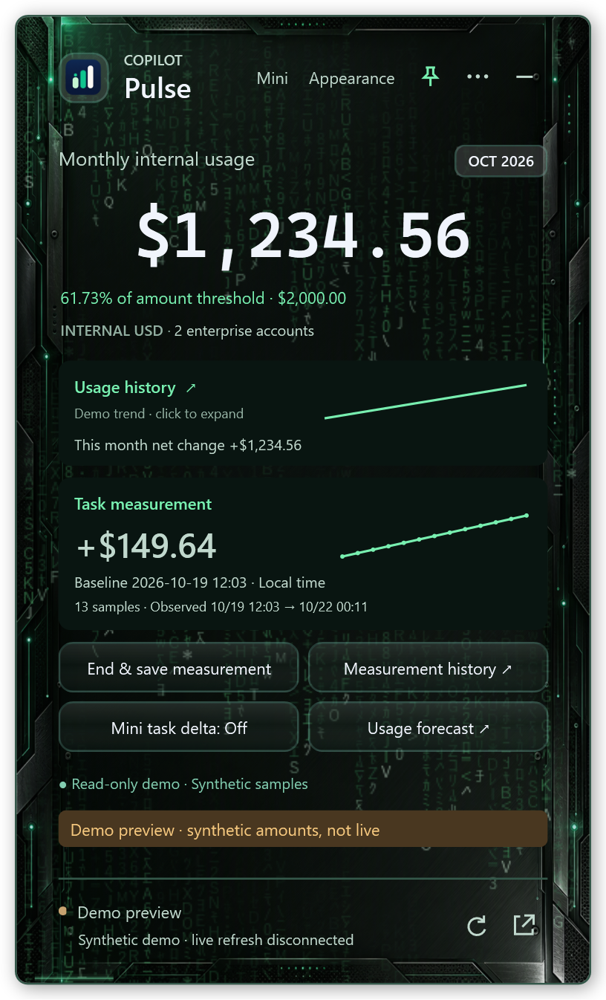

### Observe usage during a task

Choose **Start measurement**, enter a task note, and wait for the first successful sample to establish zero before starting work. Watch **Task measurement delta**; finish after source readings catch up using **End & save measurement**. **Measurement history** retains task names, times, observed increments and samples across restarts. Inspect sampling health, rename, copy a summary or export CSV / JSON / PNG.

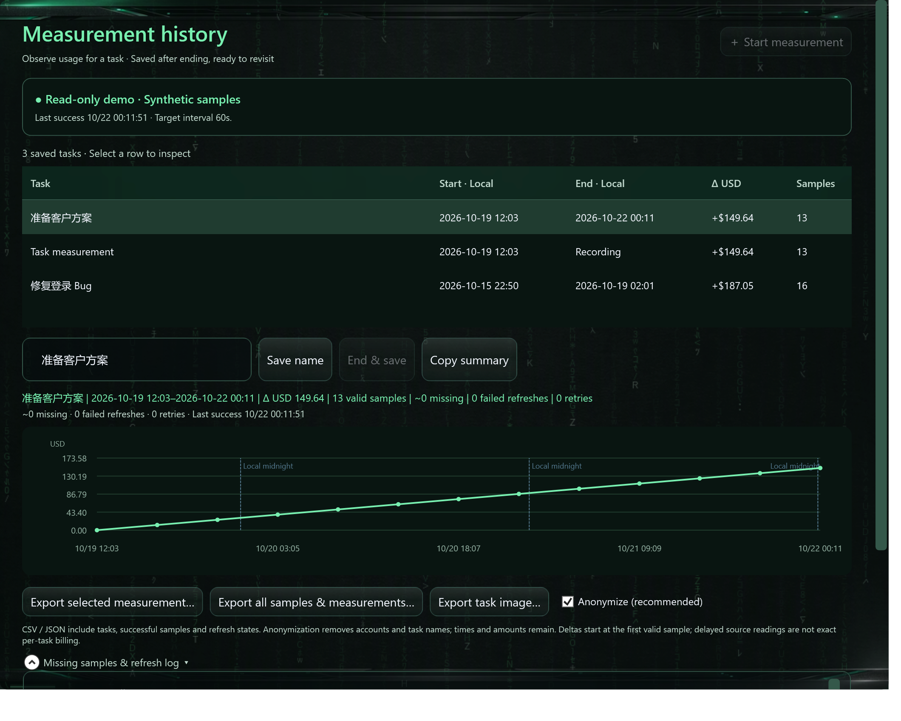

Source latency and concurrent work affect attribution; this is an observation, not an exact task bill. Missing samples are not fabricated. Anonymous exports remove account details and task names but retain timestamps, amounts and task IDs; review before sharing.

**Mini task delta remains opt-in.** Its main-panel button is disabled without an active measurement. Ending the task immediately restores monthly Overall usage. An active task awaiting its first valid sample has an explicit waiting state. Returning from mini restores the previous compact or full layout.

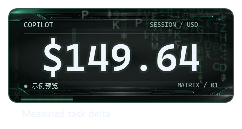

### A smaller Overall forecast

The forecast emphasizes **projected month-end usage**, **whether the target is expected to be reached**, then progress and concise statistics. Calculation: **Overall month-to-date usage ÷ elapsed UTC quota-month duration × full month duration**. It no longer scans history, splits accounts or offers comparison/rate tabs.

An amount alert threshold configured in Settings takes priority over source caps. This is a personal target, not a change to the service quota. Without it, depletion is assessed only when complete numeric source caps are available. A percentage threshold cannot be converted to an Overall amount without those caps. Muting notifications retains the target. Stale, prior-month and future readings pause forecasts. Results are estimates, not bills.

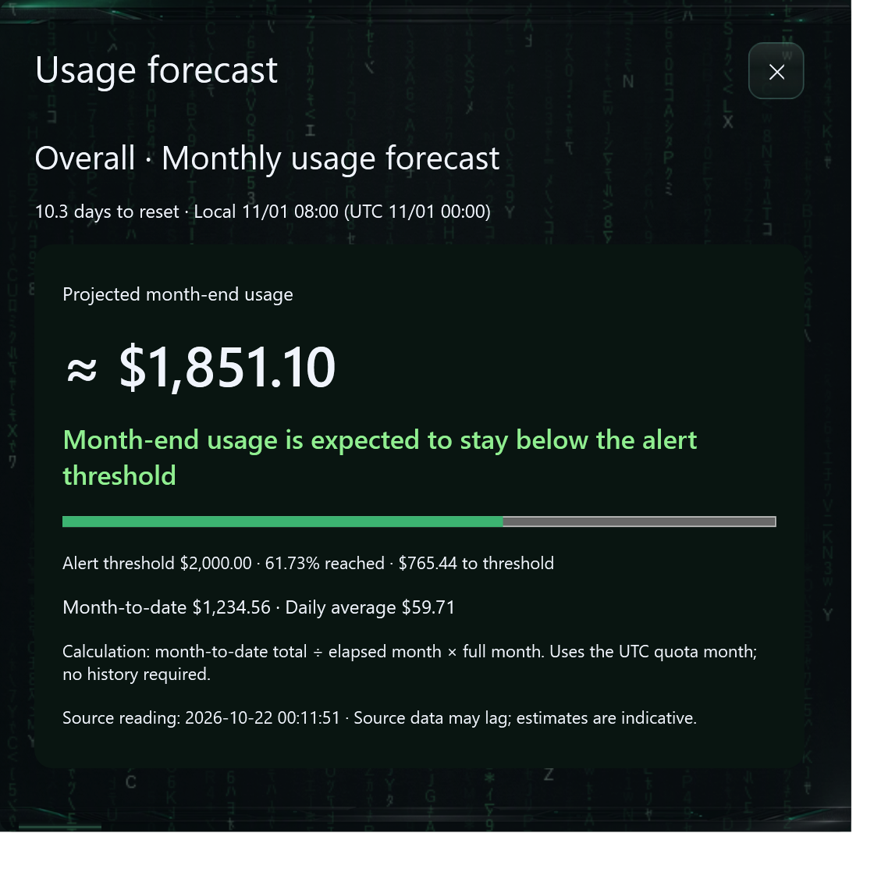

Connection actions have moved to the independent **⋯ → Connection diagnostics** window. Task comparison has been removed.

### History and notifications

Today starts at Windows local midnight. Rolling 24-hour / 7-day ranges and saved month selection remain available. Quota months reset at **00:00 UTC on the first day**, also shown in the system timezone. Net growth uses comparable observations and never assumes a missing starting value is zero.

Hover or pin points, wheel to zoom, drag to select, and double-click or right-click to reset. Refresh preserves zoom. Charts mark local midnight, UTC reset and unusual changes. History and measurement charts retain opaque backgrounds.

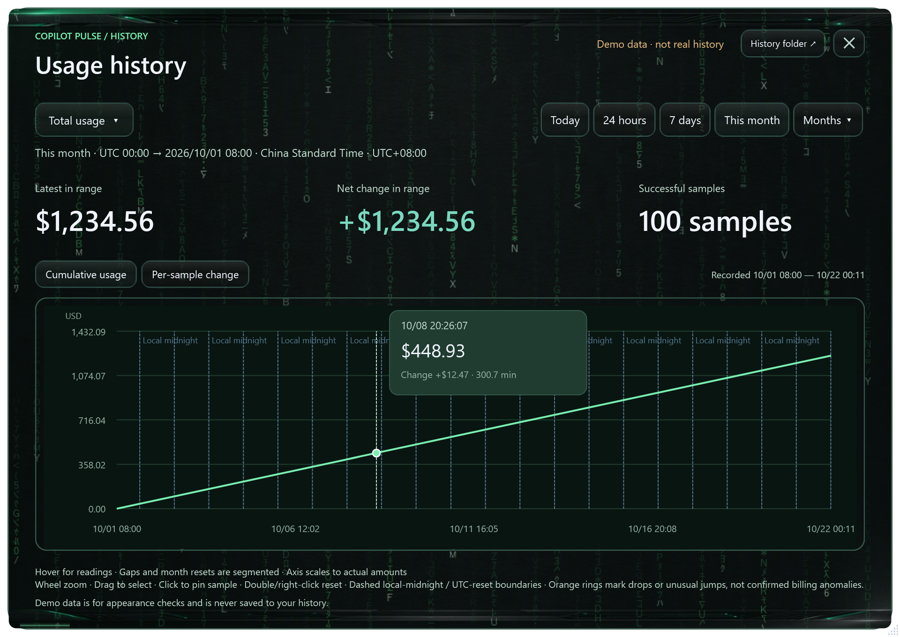

With fictional usage of $1,234.56, a $2,000 threshold shows 61.73%; a $1,000 threshold shows 123.46%, exceeding it by $234.56. Widget warnings remain visible when notifications are muted.

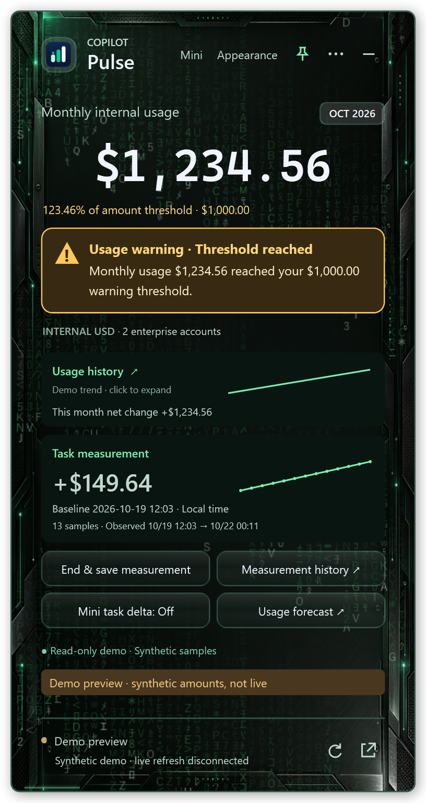

Notification appearance and delivery depend on Windows settings. Persistent cooldowns, local quiet hours, silent mode, reset reminders and sampling interruption/recovery notifications are configurable. Manual pause does not trigger interruption warnings.

### Settings and appearance

Four equal glass buttons form a compact 2×2 layout. The rounded high-resolution badge, categorized Settings, integrated skin gallery, About, Online update and task naming share the selected skin. Close / Done stay visible. Main-menu Skin opens the same settings page. Choose language, digit font, refresh rate, animation intensity/frame rate and custom background.

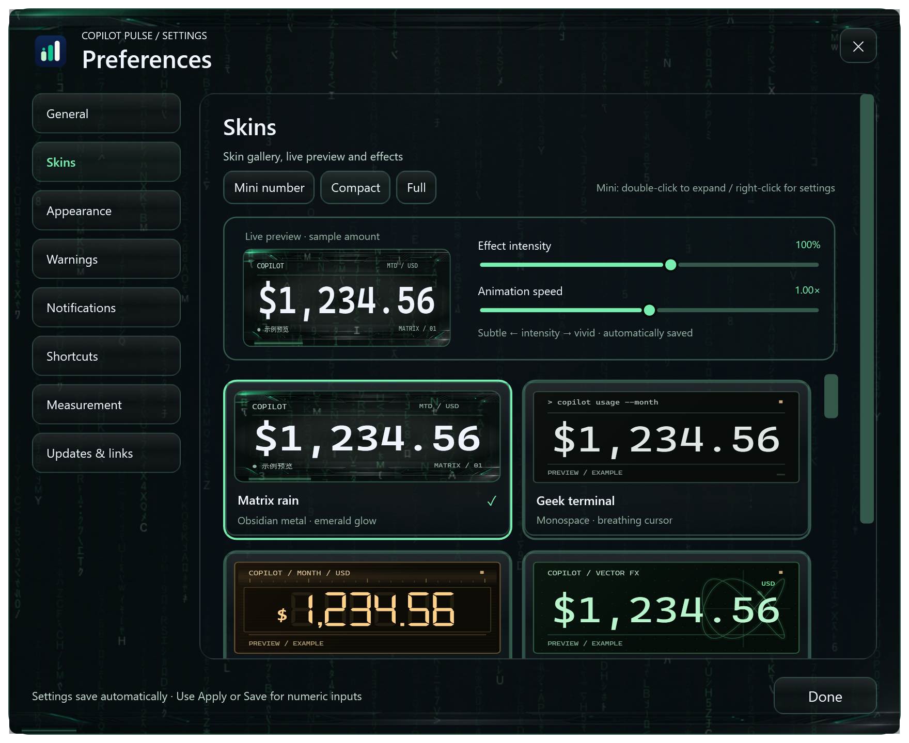

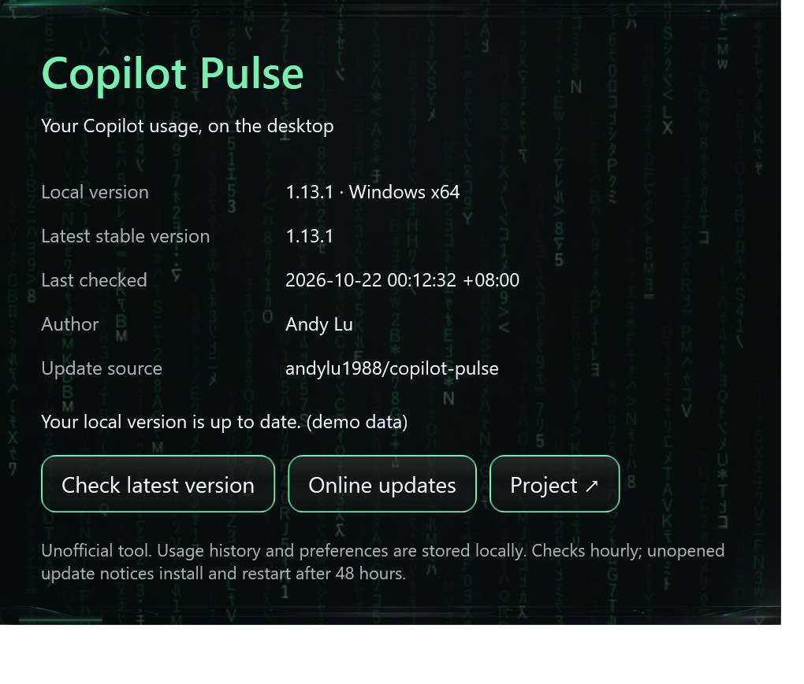

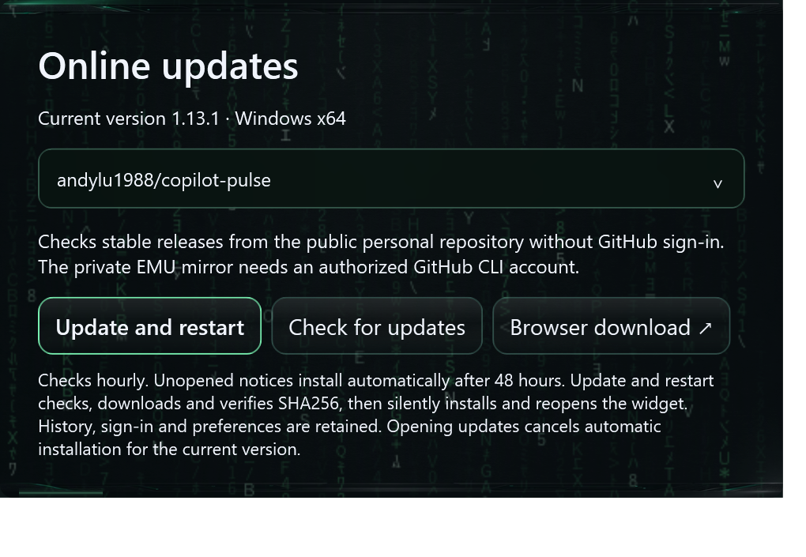

Matrix rain uses a composited frame and cached glass surfaces to reduce rendering work. The public demo menu is removed; documentation screenshots use a separate isolated review path.

Opt-in Ctrl+Alt+T / M / R / H shortcuts control task measurement, mini, refresh and recent tasks. Tray actions include pause/resume, and tray hover shows usage. Window placement supports multiple monitors. Connection diagnostics checks timezone, session, login, sampling, storage and shortcuts; anonymous reports exclude accounts, amounts, credentials, cookies, full URLs and page bodies.

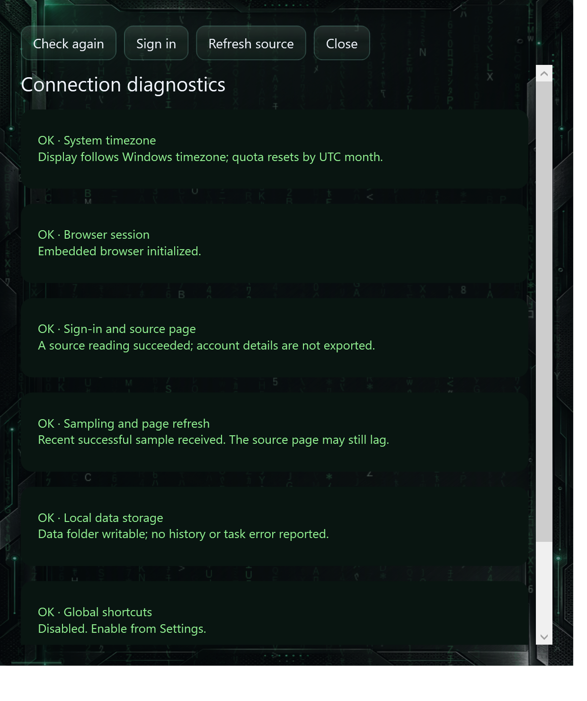

## 开发与验证 / Development

需要 Windows、.NET 8 SDK、WebView2 Runtime。

```powershell
dotnet build -c Release
dotnet run --project tests/HistoryTests/HistoryTests.csproj -- ..\test-results
```

本版通过 248 项自动检查，以及隔离界面检查。安装与更新的验证记录见本版发布说明。窗口性能取决于硬件、皮肤和动画设置。

Unofficial project. Source data is authoritative; observations and forecasts are not settled bills. 产品介绍参考 [copilot-usage-monitor](https://github.com/mcaps-microsoft/copilot-usage-monitor)，矩阵素材见 [素材说明](Assets/MATRIX-ART.md)。
