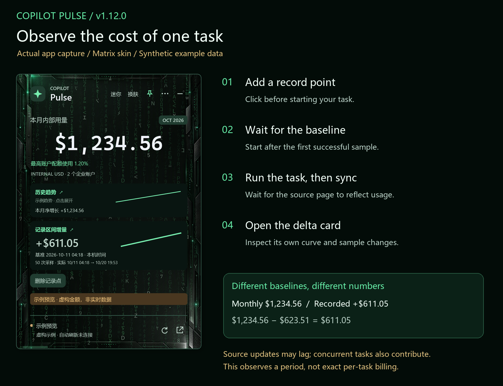
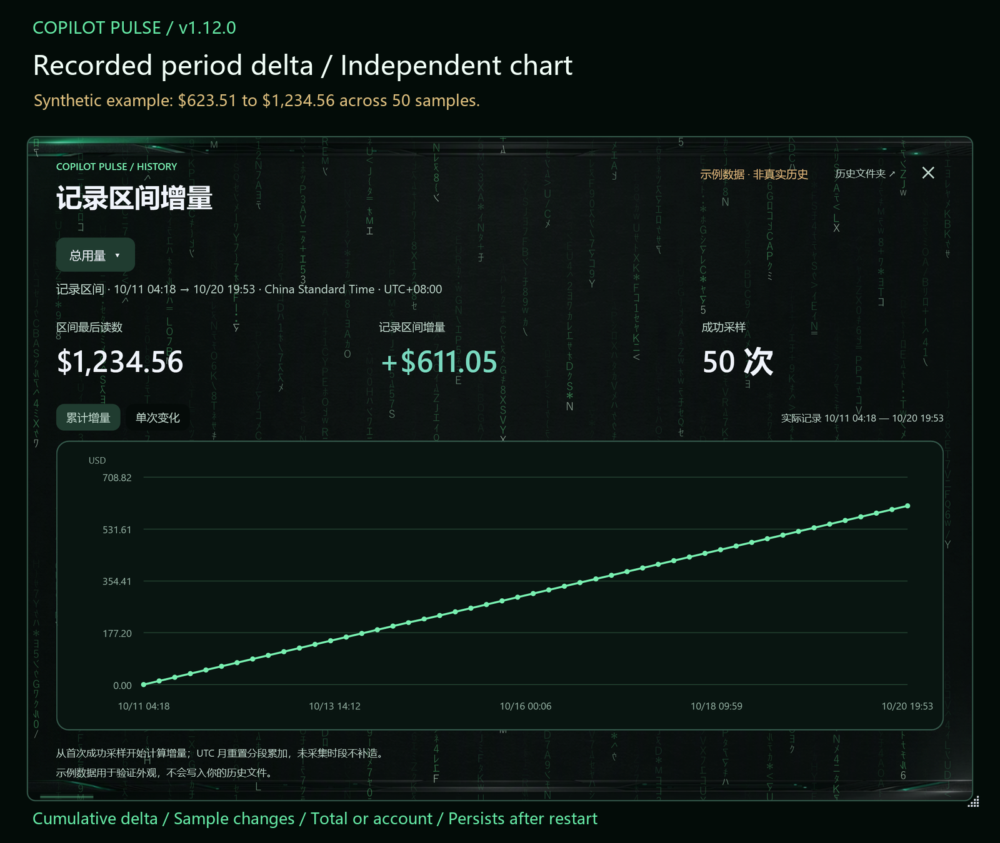
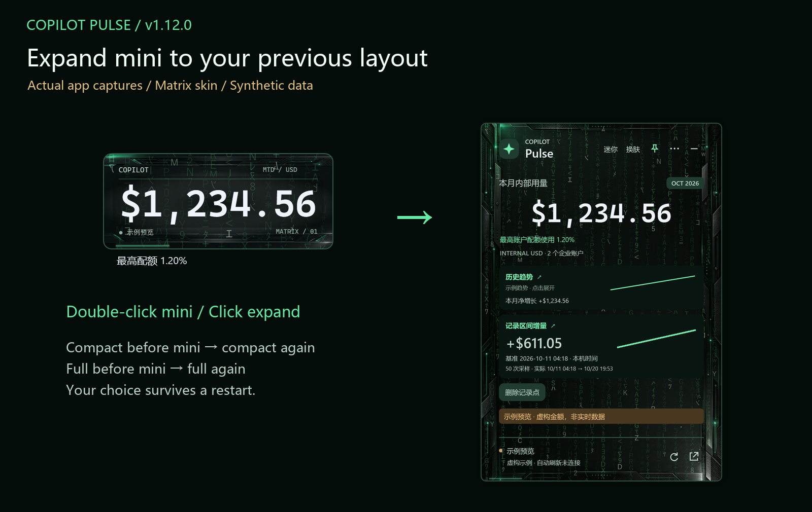

# Copilot Pulse v1.12.0

## 新增与修复

- **记录区间增量**：主界面点击“增加记录点”开始计量，按钮变为“删除记录点”。历史趋势下方显示独立增量卡片，点击可查看专属图表，支持总用量、单个账户、累计增量及单次采样变化。
- **采样持久保存**：成功刷新后采样，首个有效读数作为零基线；记录点和采样在退出、重启及升级后保留。删除记录点不删除历史。
- **自定义计量起点**：设置中按本机时间输入日期时间，自动换算 UTC；跨 UTC 配额月只累加实际采样覆盖的变化，不估算漏采数据。
- **迷你模式恢复**：展开或双击迷你框时恢复之前的紧凑 / 完整模式，重启保留。
- 修正负向采样变化在图表中的裁切问题，补充中英文使用说明。

### 用来观察单次任务的花费

“记录区间增量”适合观察一次代码生成、排查或其他 Copilot 任务前后的用量变化：

1. 任务开始前点击 **增加记录点**。
2. **等首个成功采样建立零基线后，再开始任务**。
3. 任务结束后，等待源页面反映新增用量，并让组件成功刷新。
4. 查看记录区间增量，点击卡片查看累计曲线或单次采样变化。需要重新观察时，删除记录点后再添加；原有历史保留。

这是源页面在所记录时间段内的 **INTERNAL USD 用量变化**。源页面可能延迟更新；同一期间其他任务或账户的消费也可能计入，应尽量避免并行用量，必要时选择对应账户查看。它不能精确归因到某次 API 请求，也不是单任务账单。未采集时段不会补造记录。

示例本月累计 **$1,234.56**，记录点首个读数 **$623.51**，记录后增量 **+$611.05**，共 50 次采样。这个示例覆盖多天，用于展示计算口径，不代表一次真实任务的花费。

## What's new

- **Recorded period delta**: click Add record point on the widget to begin. The button becomes Delete record point. A dedicated card and chart show total or per-account cumulative delta and individual sample changes.
- Successful refresh samples and the start point persist across restarts and upgrades. The first valid reading starts at zero. Deleting the point preserves history.
- Set a custom local start time in Settings; it is stored in UTC. Cross-month calculations sum observed within-month changes without estimating missing usage.
- Leaving mini mode restores the previous compact/full layout, including after restart.
- Fix chart clipping for negative sample changes and add Chinese/English documentation.

### Observe the cost of a single task

Use **Recorded period delta** to observe usage before and after a code-generation, troubleshooting or other Copilot task:

1. Click **Add record point** before the task.
2. **Wait for the first successful sample to establish the zero baseline before starting**.
3. After the task, wait for the source page to reflect usage and for a successful widget refresh.
4. Inspect the delta card and its cumulative curve or individual sample changes. Delete and add a new point for another observation; existing history is retained.

This measures observed **INTERNAL USD usage changes during the recorded period**. Source updates may lag, and concurrent tasks or accounts can contribute. Avoid unrelated parallel usage and select the relevant account when appropriate. It is not exact API-level attribution or a per-task bill. Unobserved periods are never fabricated.

The example monthly total is **$1,234.56**. The first recorded reading is **$623.51**, producing **+$611.05** across 50 samples. This multi-day illustration explains the calculation; it is not the cost of a real single task.

## 安装 / Installation

Download `CopilotPulse-Setup-1.12.0-x64.exe`. Existing users can use **⋯ → Online updates → Update and restart**. Settings, local history and sign-in data are retained. The installer is unsigned. Each user needs their own account and access to the internal Consumption site.

验证 / Validation: 130 history/settings/update checks, isolated UI verification and installer payload checks. SHA256 is provided alongside the installer.
