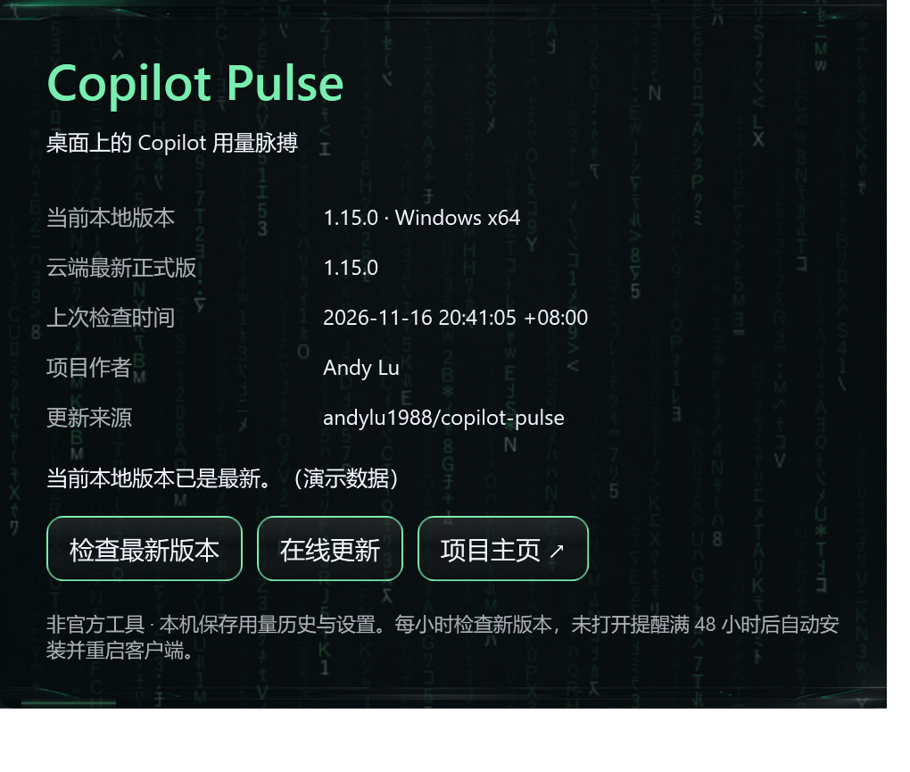
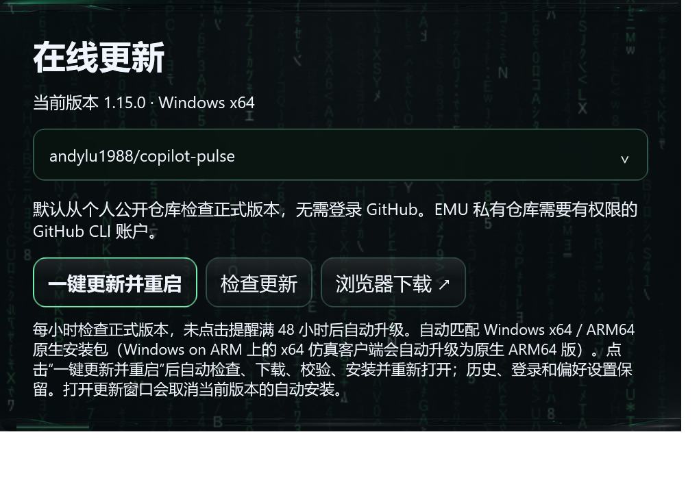
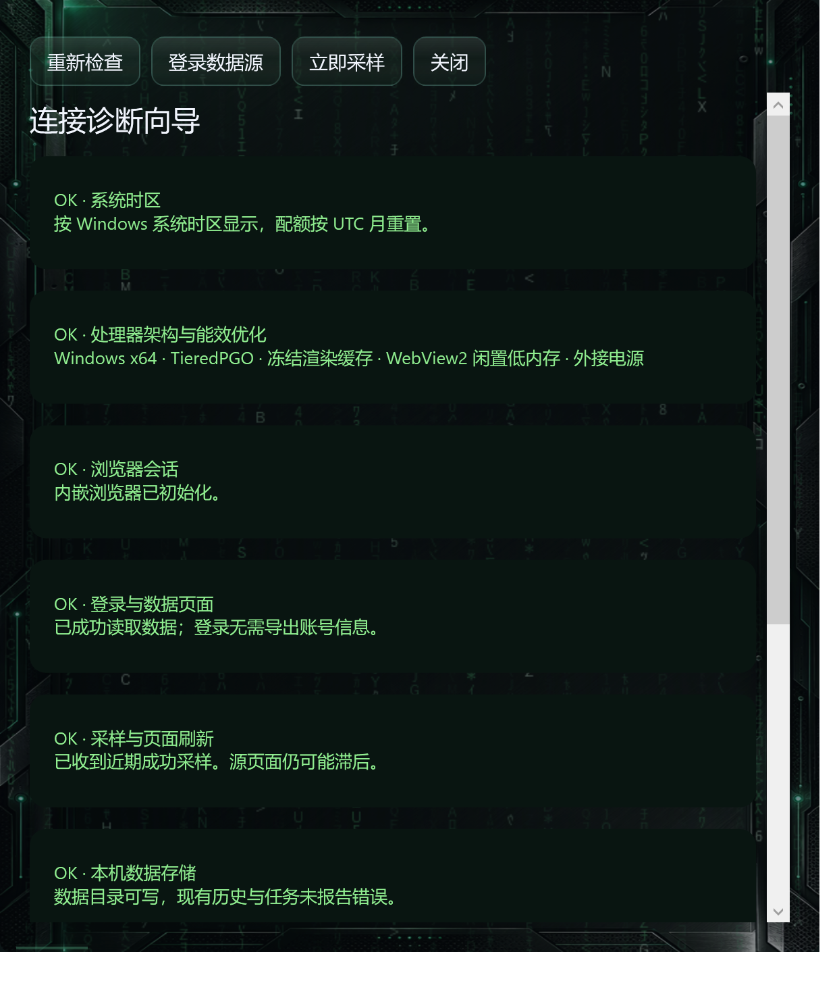
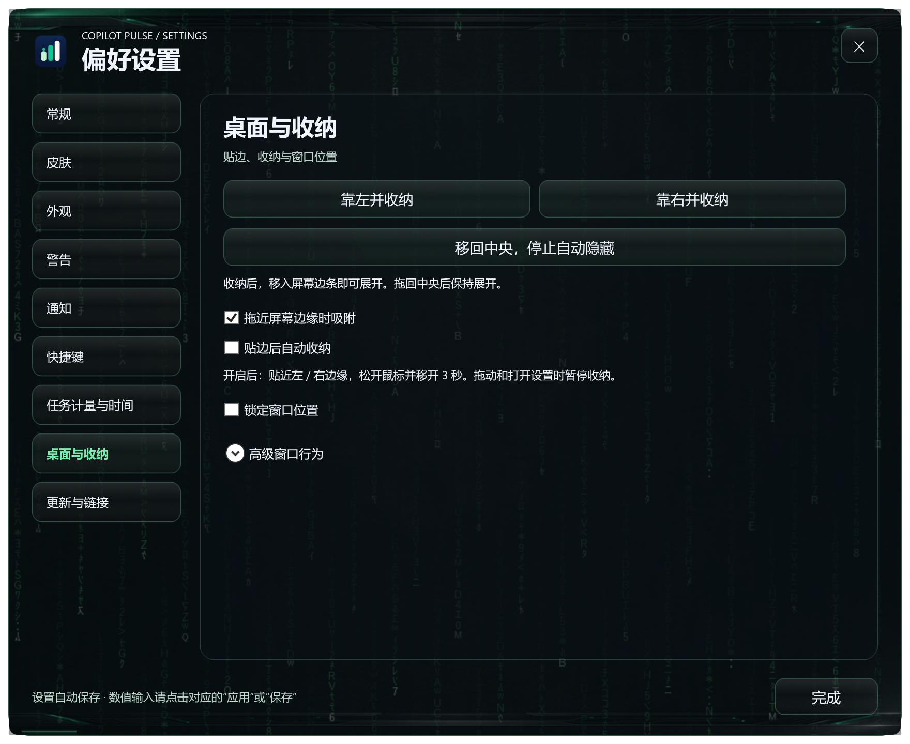
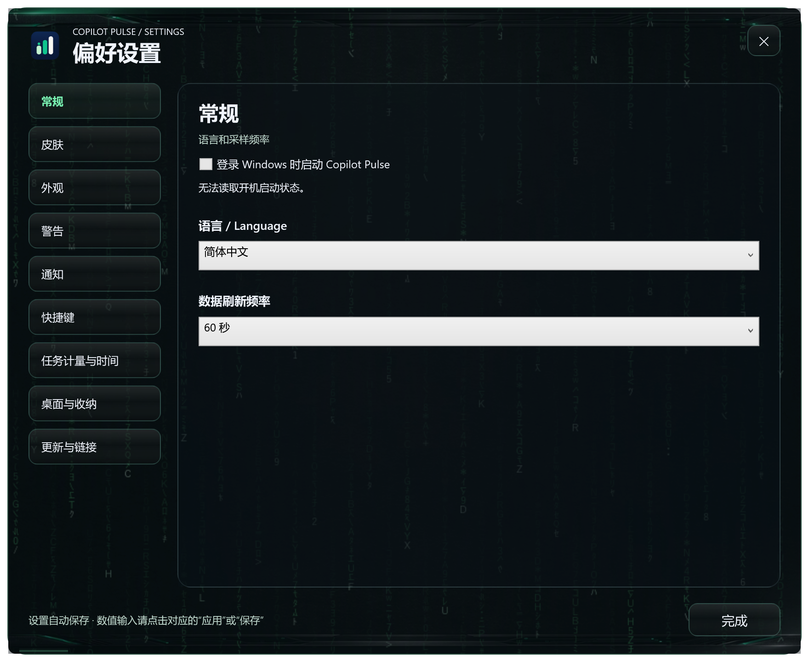
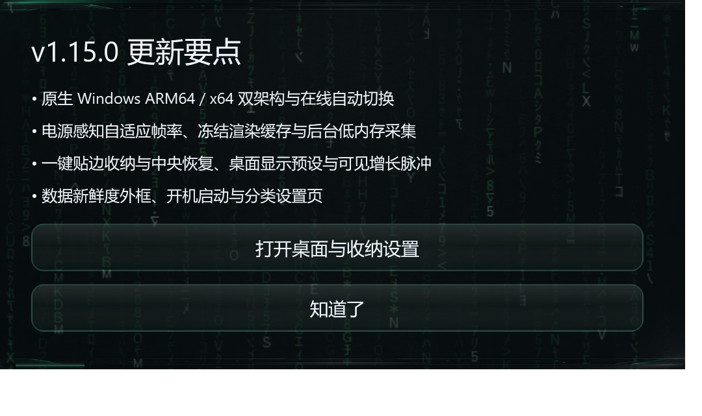

# v1.15.0 · 原生 ARM64 能效优化与桌面收纳体验 / Native Windows ARM64, power-aware rendering & desktop controls

> 2026-11-16 · [下载安装包 / Download](https://github.com/andylu1988/copilot-pulse/releases/tag/v1.15.0) · 提供 `win-x64` 与 `win-arm64` 原生安装包，支持客户端在线自动匹配架构升级 / Dual x64 & ARM64 installers with architecture-aware in-app updates.

---

## v1.15.0：原生 Windows ARM64、能效优化与桌面体验升级

**v1.15.0 已发布。** 提供 `CopilotPulse-Setup-1.15.0-x64.exe`（Intel / AMD）与 `CopilotPulse-Setup-1.15.0-arm64.exe`（Surface / Snapdragon X 等 Windows on ARM 原生版），也可在客户端打开“在线更新”自动匹配系统架构下载、SHA256 校验、静默安装并重启。以下截图使用矩阵皮肤与隔离的虚构数据。

### 1. 原生 Windows ARM64 与双架构智能在线更新

- **双架构自包含安装包（TieredPGO）**：同时发布 `win-x64` 与 `win-arm64` 自包含单目录安装包，启用 .NET 8 `TieredPGO` 编译优化。在 Windows on ARM 设备上原生运行可免除 Prism x64 指令转译开销。
- **在线更新自动切换原生 ARM64**：在线更新按操作系统架构优先匹配原生安装包；若 Windows on ARM 设备此前运行的是旧版 x64 仿真客户端，点击在线更新会自动下载并切换为原生 `arm64` 安装包（若目标版本仅提供 x64 资产则安全回退）。
- **运行架构与能效档案透明可见**：在「关于」「在线更新」与「连接诊断」窗口直接展示当前进程/系统架构标识、推荐安装包架构及 `TieredPGO` / 电源节流状态。

### 2. 电源感知渲染与后台低内存采集

- **零分配冻结渲染缓存**：画刷、画笔、字体与几何对象统一冻结复用；矩阵雨 `WriteableBitmap` 像素缓冲按能效档位自适应缩放，显著降低 GC 分配与核显带宽占用。
- **电源感知自适应帧率**：主窗口最小化或工具子窗口失焦时自动停表（`0 FPS`）；电池供电或开启 Windows 节电模式时自动平滑下调帧率上限，尊重系统关闭动画、高对比度与「减少动态效果」开关。
- **WebView2 后台低内存目标**：每次后台静默采样完成后，自动将隐藏采集 WebView2 切换至低内存目标（Low Memory Target），减少常驻内存占用。

### 3. 一键贴边收纳、拖动保护与中央恢复

- **立即贴边收纳**：三点菜单 →「桌面与收纳」→「靠左并收纳」或「靠右并收纳」，无需等待直接收起窗口并恢复鼠标交互，在屏幕边缘保留可命中、可点击的 **24 DIP** 边条，鼠标移入或点击即展开。
- **DPI 感知吸附与多屏裁剪**：吸附距离扩展至 **32 DIP**（按显示器缩放换算）；收纳态严格裁剪为 24 DIP 边条，避免内容溢出到相邻显示器。
- **拖动保护与一键恢复**：拖动期间暂停自动收纳，拖回中央或外部移动窗口后自动清理旧边缘状态，不再误跳回屏幕边缘；菜单新增「移回中央，停止自动隐藏」，一键居中并关闭贴边收纳与全屏隐藏。

### 4. 看得见的用量增长脉冲与非计费预览

- **增长脉冲提示条**：源读数产生真实正向增长时，播放强调色外框脉冲并延长增量徽章停留时间；同一采样重复渲染、切换迷你指标或 UTC 配额月重置不会误触发脉冲。
- **安全效果预览**：菜单与外观设置提供「预览用量增长脉冲」，明确标注「效果预览 · 不计入用量」，不写入历史采样、不修改真实金额。

### 5. 桌面显示预设、数据新鲜度外框与开机自启

- **桌面显示预设**：「设置 → 外观」内置 **日常看板**、**专注计量**（自动启用迷你双指标与贴边收纳；无活跃任务时显示今天增量）、**安静桌面**（迷你无置顶、关闭动效）和 **屏幕分享**（紧凑面板并开启金额隐藏），不改动数据源、历史或告警阈值。
- **数据新鲜度融入外观**：可选按采样状态切换外框色彩——皮肤强调色为实时正常、蓝色为同步中、琥珀色为数据延迟/缓存、珊瑚色为连接或登录异常、灰色为暂停或等待首次读数；悬停可看最近成功采样时间。
- **登录 Windows 时启动**：「设置 → 常规」新增当前用户开机自启开关（默认关闭，带空格路径自动加引号；卸载时仅清理指向当前安装目录的启动项）。
- **分类设置与分组菜单整理**：设置页按「常规 / 外观 / 任务计量与时间 / 桌面与收纳」清晰归位；三点菜单按显示、桌面、任务、用量、数据分组，并更新 `v1.15.0`「这次改了什么」说明卡。

### 验证范围与已知说明

- 核心数据、时间边界、预估、任务、架构匹配与 SHA256 更新校验：**299 项自动化检查通过**（`HistoryTests`）。
- 隔离软件渲染 WPF 界面检查：**96 项检查通过**（`--review-workspace`），覆盖皮肤圆角轮廓一致性、增长脉冲触发/抑制与预览、数据新鲜度状态框、四种桌面预设、左右贴边收纳与 24 DIP 命中/裁剪、拖动保护与中央恢复、开机启动注册表隔离保护，以及关于/更新/诊断架构信息展示。
- 打包与宿主说明：双架构安装包在 Windows x64 构建机上由洁净临时目录独立发布打包并校验 PE 头（`x64` = `0x8664`，`arm64` = `0xAA64`）与 SHA256；`win-x64` 安装包已在本机完成静默安装升级实测，`win-arm64` 安装包为交叉编译打包产物，待实际 Windows on ARM 硬件日常使用反馈。安装包尚未使用企业代码签名证书签名。

---

## v1.15.0: Native Windows ARM64, power-aware rendering and desktop controls

**v1.15.0 is available.** Download `CopilotPulse-Setup-1.15.0-x64.exe` (Intel / AMD) or `CopilotPulse-Setup-1.15.0-arm64.exe` (native Windows on ARM for Surface / Snapdragon X), or open **Online updates** in the app to automatically select, SHA256-verify, silently install and restart the matching architecture build. Screenshots use the Matrix skin with isolated fictional data.

### Native Windows ARM64 & architecture-aware updates

- **Dual self-contained installers with `TieredPGO`**: Native `win-arm64` and `win-x64` builds eliminate Prism x64 translation overhead on Windows on ARM devices.
- **Automatic x64-to-ARM64 migration**: On ARM64 Windows, in-app updates prefer `CopilotPulse-Setup-<version>-arm64.exe` even when invoked from an older emulated x64 installation, with safe fallback to `x64` if a release only ships x64 assets.
- **Runtime & optimization visibility**: About, Online updates and Connection diagnostics surface process/OS architecture badges, matched installer architecture and `TieredPGO` / power-throttling profiles.

### Power-aware rendering & low-memory background sampling

- **Frozen render caches & adaptive Matrix buffer**: Reusable frozen brushes/pens/typefaces and adaptive `WriteableBitmap` scaling reduce GC churn and integrated-GPU bandwidth.
- **Power-aware FPS pacing**: Animation timers drop to `0 FPS` when minimized or when utility windows lose focus, and scale down smoothly on battery power or Windows Energy Saver while honoring Reduce Motion and system animation settings.
- **Idle WebView2 memory target**: After each background usage sample completes, the hidden WebView2 instance switches to a low memory target.

### Immediate edge tuck, visible growth pulse, presets & startup

- **Immediate left/right tuck & center recovery**: Tuck left or right immediately from the **Desktop & tuck** menu without waiting for idle timeout; leaves a hit-testable **24 DIP** edge strip clipped cleanly on multi-monitor setups, pauses auto-hide while dragging, snaps within **32 DIP** (DPI-aware), and offers one-click **Move to center & stop auto-hide**.
- **Visible usage-growth pulse & safe preview**: Extended growth badge hold on newer positive source samples, plus an unrecorded **Preview usage growth pulse** action that never alters history or totals.
- **Desktop display presets, freshness frame & launch at sign-in**: One-click **Daily glance**, **Focus measurement**, **Quiet desktop** and **Screen sharing** presets; optional border color coding for live, syncing, delayed/cached, connection-error and paused states; per-user **Launch Copilot Pulse at Windows sign-in** toggle; reorganized Settings tabs and grouped main menu.

### Verification notes

Validated on Windows x64 with **299** automated core/update/architecture checks and **96** isolated WPF UI checks, clean-room `win-x64` (`0x8664`) and cross-compiled `win-arm64` (`0xAA64`) installer builds with SHA256 digests, and local `win-x64` upgrade verification preserving user history and WebView2 sessions. Real Windows on ARM hardware feedback is welcome.
