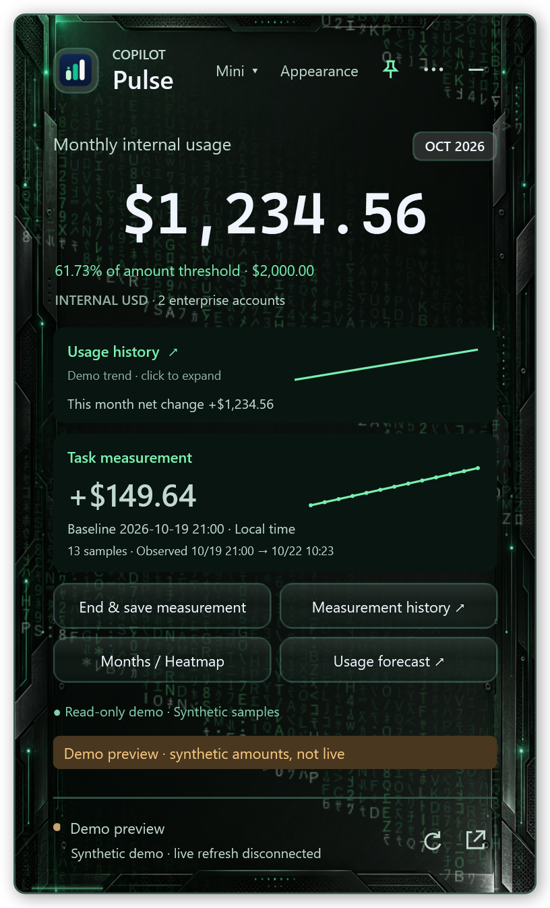
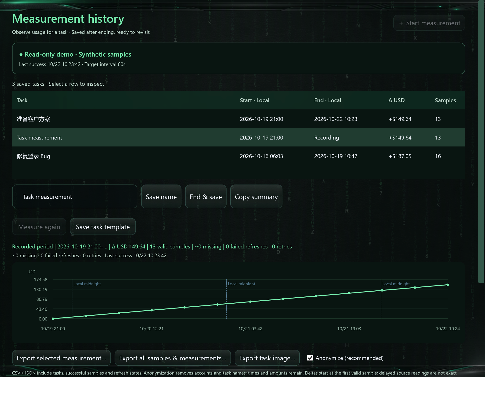
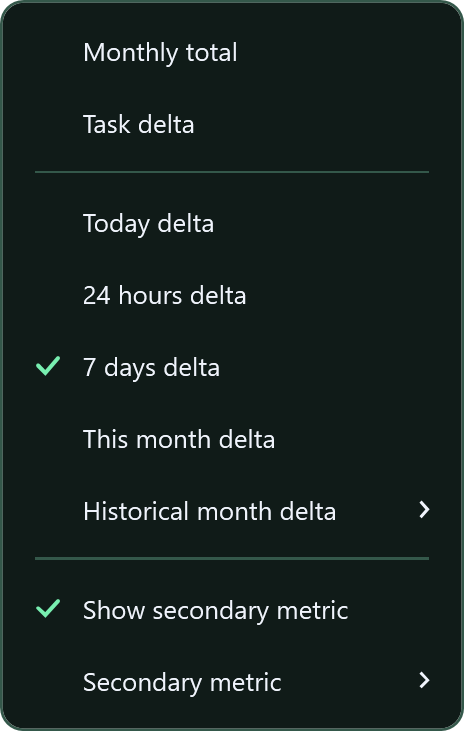
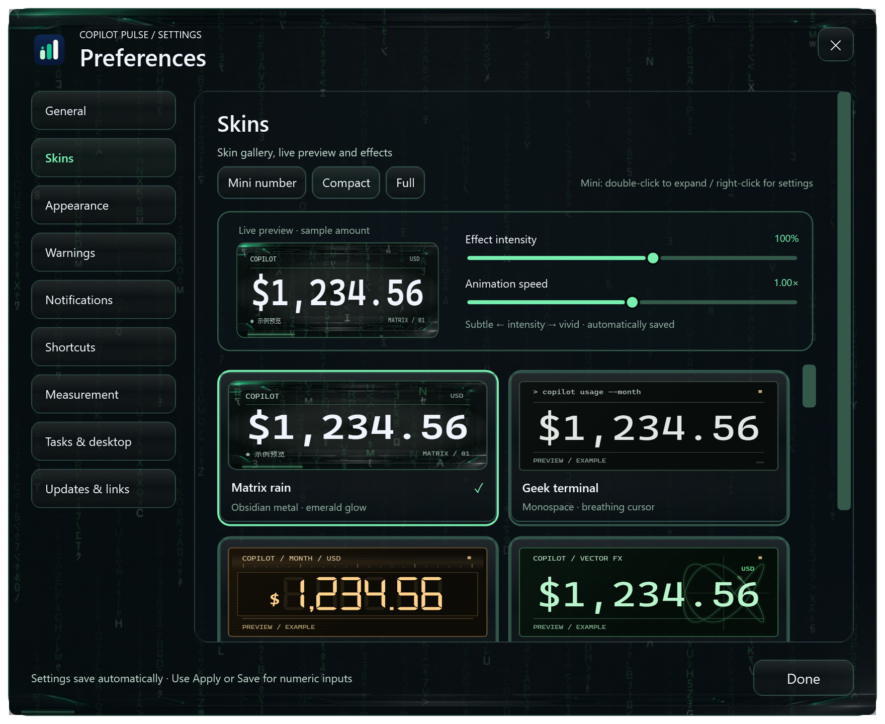
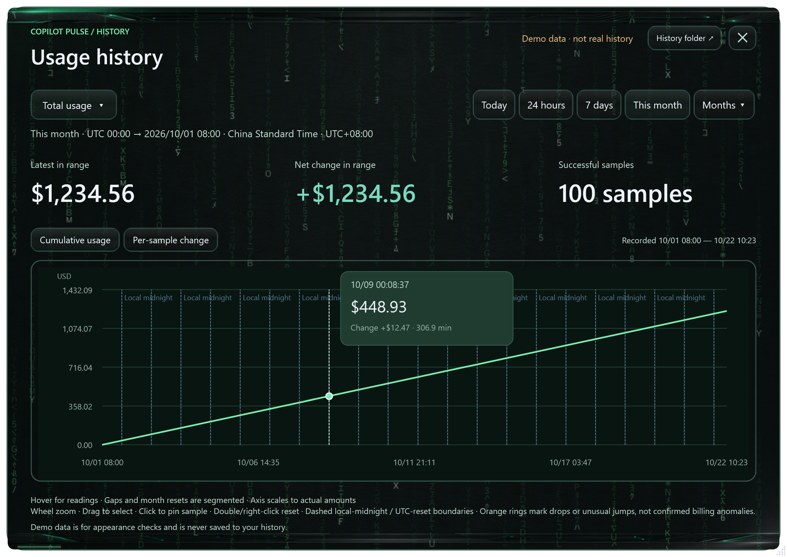

# User guide · v1.14.0

[Project overview](../README.md) · [Version history](UPDATES-SINCE-v1.12.0.md)

## v1.14.0: task observations and desktop controls

**v1.14.0 is available.** Download the Windows x64 installer from GitHub or use Updates in the app to download, verify, install and restart automatically. Screenshots use the Matrix skin with isolated fictional data.

### Named tasks and delayed settlement

Start a measurement, enter a note or choose a saved template, and wait for the first successful sample before working. Add timeline markers such as “Run tests” or “Switch model”. End & save now waits for 3 new successful samples, up to 10 minutes, to observe delayed source changes. Finish immediately to skip waiting; a timeout remains unconfirmed. Measurement history supports Measure again, renaming, summaries, sampling-health details and CSV / JSON / PNG exports.

Use it to observe a bug fix, review, image-generation session or proposal task. Source latency and concurrent activity affect the delta. Markers are time notes and do not identify model costs; observations are not exact task bills.

### Independent primary and secondary mini metrics

Use **Mini ▾** or the mini panel context menu to choose the main metric, enable dual metrics and choose the secondary metric. Monthly total, Today, rolling 24 hours / 7 days, current month and saved-month changes are available. Task delta is available only while a task is active.

**Monthly total plus Today or 7-day delta works without starting a task.** Unavailable task metrics fall back safely; insufficient samples show a waiting state. Choices persist, and expanding mini restores the previous compact/full mode.

### Daily heatmap and monthly archive cards

The main **Monthly records / Heatmap** action opens the corresponding tab inside Usage forecast. Choose a month; each cell shows daily observed change. Click a date for its exact amount and sample count. Missing samples are distinct from zero; today and the selection are highlighted. Monthly cards summarize available month-end usage, coverage, busiest day and saved tasks and can be copied as an image. Daily observed changes may not sum to the source monthly total because gaps are not fabricated.

### Overall forecast and alerts

The compact forecast prioritizes projected month-end total, target risk, progress and concise statistics. It uses Overall month-to-date usage ÷ elapsed UTC quota-month time × total month time. A configured amount alert target takes priority and does not change the service quota. Without an amount target or complete numeric source caps, depletion cannot be assessed. Stale, prior-month and future readings pause forecasting.

Amount threshold progress remains visible even with muted notifications. Fictional usage of $1,234.56 is 61.73% of $2,000; against $1,000 it is 123.46%, exceeding the target by $234.56. Cooldowns, quiet hours, silent mode, reset and sampling interruption/recovery alerts are configurable. Windows controls notification delivery.

### Privacy, animation and desktop placement

Manually hide amounts before sharing a screen: both mini values are masked while progress and status remain. Amount-detail views require protection to be disabled. Screen sharing is not detected automatically. Optional growth pulses briefly emphasize increased readings. Edge snapping, tuck after 3 seconds, hover to reveal, fullscreen hiding, desktop position lock and click-through reduce obstruction; tray controls or Ctrl+Alt+P restore interaction. A What's new card summarizes changes and links to settings.

Manage these controls under **Settings → Tasks & desktop**. The Skin shortcut opens the integrated skin gallery. Language, sampling interval, digit fonts and animation settings remain configurable; About, Updates and utility windows follow the skin. Chart backgrounds remain opaque for legibility.

History supports local Today, rolling ranges and UTC quota months, hover, pinning, zoom, range selection and change markers. Refresh retains zoom. Quota months reset at 00:00 UTC on day 1, also displayed in the system timezone. Missing baselines are never assumed to be zero. Optional Ctrl+Alt+T / M / R / H shortcuts, tray sampling controls and independent **⋯ → Connection diagnostics** remain available.

## 安装、登录与数据 / Installation, sign-in and data

1. 当前正式版为 [v1.14.0](https://github.com/andylu1988/copilot-pulse/releases/tag/v1.14.0)，Windows 10 1809+ / Windows 11 x64，需 WebView2。
2. 启动后点击 **连接 Microsoft 账户**，使用自己的、有源站权限的公司账户完成官方登录，等待首个成功同步。
3. WebView2 尝试 Windows 公司账户 SSO，不保证复用浏览器会话或 PRT。安装包不含作者账号、会话或密钥。
4. 正式版支持每小时检查、48 小时提醒期及下载校验后安装并重启客户端；Windows 无需重启。v1.14.0 正式版已启用在线更新。

上图中间栏是操作说明，不是登录页截图。每位用户使用自己的登录会话；安装器尚未做发布者代码签名。

本机数据目录为 `%USERPROFILE%\Documents\Codex\CopilotPulse-data`：`history/yyyy-MM.jsonl` 为历史、`sampling/yyyy-MM.jsonl` 为采样事件、`tasks.json` 为任务、`preferences.json` 为设置、`reminders.json` 为提醒状态。升级和卸载保留数据，备份前正常退出应用。历史从采样开始积累，未运行期间的数据无法回补。

这是个人开发的非官方辅助工具，金额为源页面 INTERNAL USD，请以源站为准。本地文件未额外加密；匿名任务导出仍含时间、金额和任务 ID，分享前应检查。诊断报告排除账户、金额、凭据、Cookie 和网页正文。

Install the stable x64 release, connect your own authorized corporate account, and wait for synchronization. WebView2 attempts Windows-account SSO; browser-session/PRT reuse is not guaranteed. No author credentials are included. Stable clients support hourly update checks and download / checksum / install / app restart; unopened notices trigger unattended installation after 48 hours. v1.14.0 supports in-app updates. Local unencrypted history, task and sampling files survive upgrades/uninstall; missing data cannot be backfilled. Anonymous task exports still contain timestamps, amounts and IDs. This is an unofficial observation tool; source readings remain authoritative.
