# Copilot Pulse 介绍与使用指南

**适用版本：1.12.0 · Windows 10 1809+ / Windows 11 · x64**

Copilot Pulse 把 Microsoft 内部 Copilot Consumption 页面变成桌面仪表盘。平时用迷你框看总金额，需要了解增长时展开历史，也可以换上矩阵雨、液晶、霓虹或机甲风格，让它融入自己的桌面。

[项目首页](../README.md) · [下载安装](https://github.com/andylu1988/copilot-pulse/releases/latest) · [版本记录](../CHANGELOG.md)

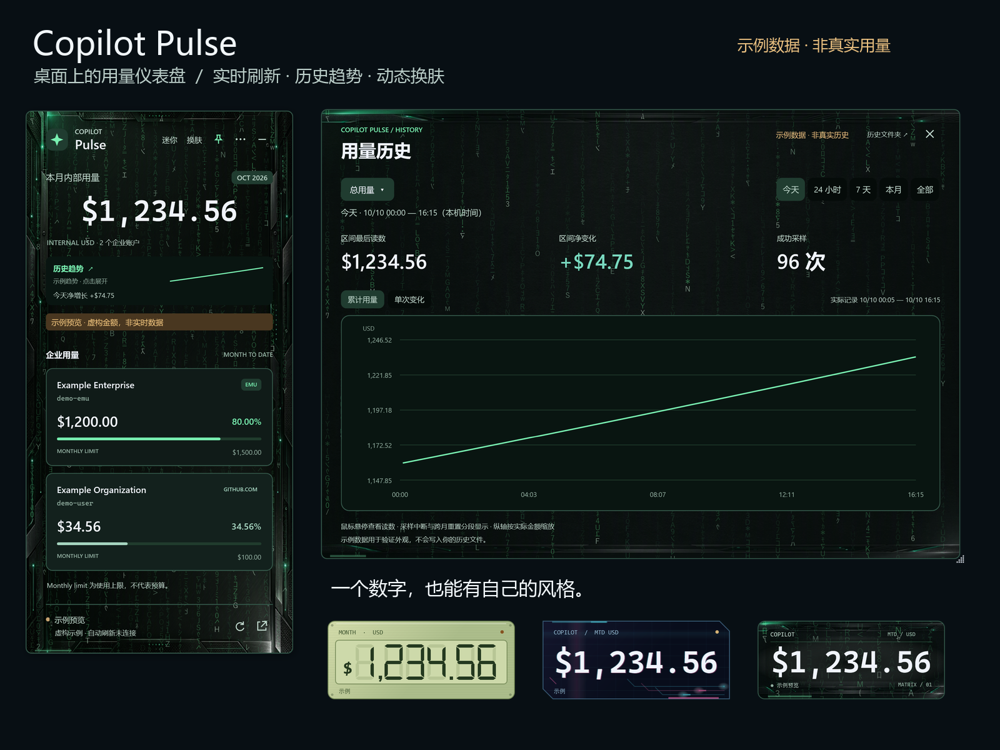

> 所有账户、金额、百分比和历史均为虚构示例。截图来自实际应用控件的隔离示例渲染，保留“示例”标记，没有读取真实账户或用量。示例不是实际账单，也不表示应用会生成真实历史。

## 目录

- [1. 适用人群与数据口径](#1-适用人群与数据口径)
- [2. 安装与第一次登录](#2-安装与第一次登录)
- [3. 读懂主界面](#3-读懂主界面)
- [4. 三种显示模式](#4-三种显示模式)
- [5. 刷新与桌面操作](#5-刷新与桌面操作)
- [6. 历史趋势与区间净增长](#6-历史趋势与区间净增长)
- [7. 换肤与自定义背景](#7-换肤与自定义背景)
- [8. 保存备份升级与分享](#8-保存备份升级与分享)
- [9. 常见问题](#9-常见问题)
- [10. 功能边界与参考](#10-功能边界与参考)

## 1. 适用人群与数据口径

适合能访问 [内部 Copilot Consumption 页面](https://copilot.github.microsoft.com/?section=limits&tab=consumption)，希望随时了解本月用量与变化的用户。安装应用不会自动获得该站点权限。

应用显示页面提供的 GitHub Copilot 企业消费信息，包括本月累计金额、企业账户、消耗比例和 Monthly limit，金额标为 **INTERNAL USD**。它不统计所有 Copilot 产品、所有 AI 服务或个人订阅开销。

**Monthly limit 是页面的使用上限，不代表个人预算。** 应用定期读取页面并保存采样，数据解释与核对以源站点为准。

## 2. 安装与第一次登录

### 准备条件

| 条件 | 说明 |
| --- | --- |
| 系统 | Windows 10 1809+ / Windows 11，x64。 |
| 账户与网络 | 自己的账户能访问内部页面，并满足组织网络与登录策略。 |
| 下载权限 | 个人仓库公开，可直接下载；EMU 镜像需要仓库访问权限。 |
| 运行环境 | 安装包自带 .NET 8 Desktop Runtime；缺少 WebView2 时安装官方运行环境。 |

### 安装步骤

1. 在 [Releases](https://github.com/andylu1988/copilot-pulse/releases/latest) 下载 `CopilotPulse-Setup-1.12.0-x64.exe`。
2. 双击按向导安装，可勾选桌面快捷方式。默认位置：`%LOCALAPPDATA%\Programs\CopilotPulse`。
3. 缺少 WebView2 时，等待微软官方引导程序联网完成安装。
4. 从桌面快捷方式或开始菜单启动 Copilot Pulse。

安装通常无需管理员权限。安装包目前未签名；若组织策略阻止安装，按所在组织的软件审批流程处理。

### 登录自己的账户

启动后会尝试通过 WebView2 使用 Windows 主账户 SSO。设备和策略支持时可能直接登录；多账户、MFA 或条件访问也可能要求交互验证。

显示“连接 Microsoft 账户”时点击登录，或从菜单选择“Windows 账户登录 / 数据源”。完成验证后确认页面中的实际账户和月份，再等待读取成功。


1. 点击主卡片的“连接 Microsoft 账户 ↗”，或菜单中的“Windows 账户登录 / 数据源”。
2. 组件显示 Microsoft 登录与数据源窗口。核对自己的 corp 账户，按组织要求完成账户选择、MFA 或条件访问验证。系统 SSO 已成功时不需要重复登录。
3. 等待 Consumption 标签加载，组件自动读取金额。看到“已同步”和企业明细即完成。若仍显示“页面数据未就绪”，打开数据源确认页面权限、标签和网络，再点击刷新。

图中左右栏由 v1.9.8 实际控件渲染，金额和账户虚构；中间栏仅说明官方登录流程，实际认证界面可能因账户、设备和组织策略不同。

**每个使用者登录自己的账户。** 安装包不带作者的会话。系统浏览器与 WebView2 会话分别管理，所以浏览器已登录并不保证组件立即登录。组件不导入浏览器 Cookie，不读取或导出 PRT，也不保存用户输入的密码。已有 WebView2 会话可能继续使用上次账户，多账户环境应核对组件数据源窗口中的实际身份。

## 3. 读懂主界面

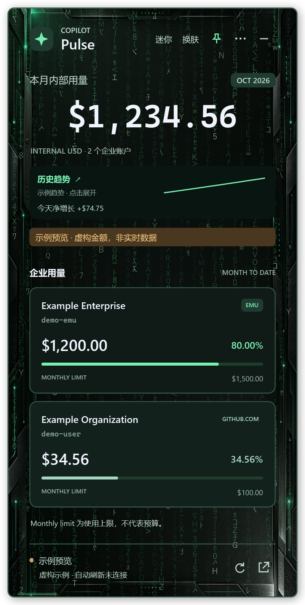

| 区域 | 含义 |
| --- | --- |
| 本月内部用量 | 当前读数中企业用量的合计，是累计金额。 |
| 月份与企业数 | 该读数对应的月份和企业账户数量。 |
| 历史趋势 | 小曲线与所选区间总用量净增长；点击打开详细图表。 |
| 企业卡片 | 企业名称、登录名、金额、比例与 Monthly limit。 |
| 底部状态 | 连接、暂停和读取情况；失败时会标记缓存。 |
| 刷新按钮 | 立即尝试读取。 |
| 打开页面按钮 | 在系统浏览器打开原始页面，方便核对。 |

截图使用两个虚构企业，`$1,200.00 + $34.56 = $1,234.56`。80.00% 和 34.56% 对应各自示例使用上限，不表示个人预算消耗。

## 4. 三种显示模式

| 模式 | 内容 | 适合场景 |
| --- | --- | --- |
| 完整 | 总金额、月份、趋势、净增长、企业明细和状态。 | 查看企业与消耗比例。 |
| 紧凑 | 隐藏企业明细，保留金额、趋势、净增长与状态。 | 日常常驻，节省空间。 |
| 迷你数字 | 突出一个金额，保留皮肤和简要状态。 | 桌面角落或第二屏。 |

通过设置 → “显示模式”或换肤窗口的模式选项切换。主窗口“迷你”按钮可快速收成数字框；**双击迷你框展开，恢复先前的紧凑或完整模式（重启保留）**，右键打开设置，悬停显示操作入口。迷你模式不显示区间净增长小字。

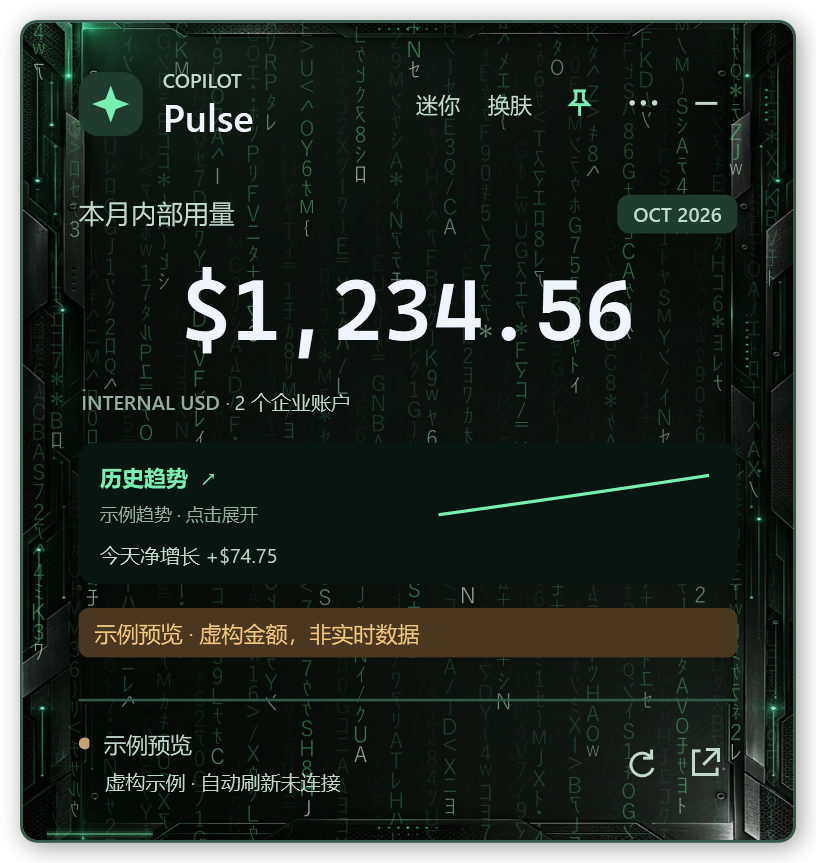


## 5. 刷新与桌面操作

### 偏好设置

从主卡片 ⋯ → 设置…、迷你框右键 → 设置… 或托盘右键 → 设置打开。

- **语言**：简体中文 / English，主界面、历史、换肤及菜单立即切换，重启保留。
- **动画帧率**：10/15/20/30/60 FPS，默认 20；影响主卡片、迷你数字、历史背景及换肤预览。帧率越高通常越流畅，也可能增加资源占用；“减少动态效果”和 Windows 减少动画设置仍有效。
- **用量警告**：默认关闭。启用后可选各账户配额百分比（1–100%）或本月合计金额（$0.01–$1,000,000,000）。修改数字后点击应用或按 Enter；无效数字不会覆盖原阈值。
- **提醒规则**：按成功同步数据判断，达到阈值显示主卡片提示和 Windows 通知。无具体限额账户不触发百分比警告，可使用合计金额。每次运行中，同 UTC 月份、账户与阈值只通知一次；重启、改阈值或新月份可再次提醒。Windows 可以禁止或隐藏通知。
- **时区**：读取 Windows 系统时区并显示 UTC 偏移及下次重置的本机时间。“今天”按本机午夜，月份按 UTC 月初午夜；运行中更改系统时区一分钟内更新，支持夏令时转换。
- **网页链接**：用量网页、使用文档及 EMU 项目在系统默认浏览器打开。

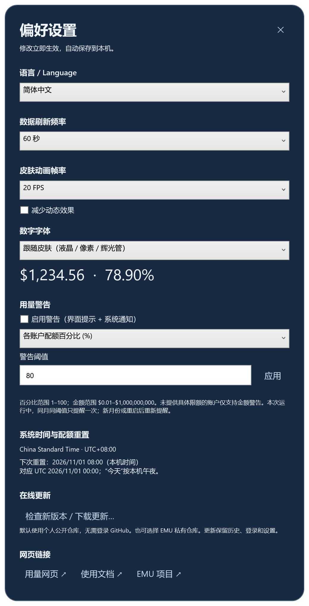

### 刷新频率

⋯ → 设置 → “数据刷新频率”支持 15、30、60、120、300、600 秒，默认 60 秒。底部刷新按钮立即尝试读取，“暂停自动刷新”停止定时采集。

刷新只是重新读取，不会让网站加快统计。没有新增消费或网站尚未更新时，多次刷新也可能金额不变。连接失败会保留并标记上次成功读数；首次没有有效数据时不会把示例金额当真实金额显示。

### 移动置顶与托盘

拖动窗口背景、标题、普通文字或金额区域移动；按钮、输入框、滑块及图表保留原有操作。图钉或“始终置顶”控制是否保持在其他窗口上方。

最小化按钮把组件收起到托盘，隐藏后自动刷新仍可继续，特效停止。双击托盘图标恢复窗口。在设置或托盘菜单选择“退出 Copilot Pulse”才完全退出。

程序退出、暂停、电脑休眠或连接失败期间无法采集，恢复后不会回补未记录时段。应用未内置开机启动设置。

## 6. 历史趋势与区间净增长

点击主卡片“历史趋势”，或设置 → “用量历史”。

### 五种时间范围

| 范围 | 起止时间 | 适合用途 |
| --- | --- | --- |
| 今天 | 本机日期 00:00 到当前时间。 | 查看自然日，跨午夜自动切换。 |
| 24 小时 | 当前时间向前滚动 24 小时。 | 会包含昨天的一部分。 |
| 7 天 | 当前时间向前滚动 7 天。 | 最近一周走势。 |
| 本月 | 当前 UTC 月份第一天 00:00 到现在。 | 本月配额累计变化。 |
| 月份 ▾ | 选择本机已有记录的 UTC 月份，结束于下个月 UTC 00:00 之前。 | 单独查看某个月，选择重启后保留。 |

点击“月份 ▾”会列出本机已有记录的 UTC 月份。没有记录时显示提示；选择旧月份后只读该月份的历史，主卡片的小曲线和净增长同步切换。旧版“全部”偏好升级后回到“本月”。


“今天”的横轴固定从午夜到现在。如果 09:00 才启动，午夜至 09:00 没有采样，应用不会把第一笔金额回填到午夜。图表随新增记录、时间推进和跨日刷新。

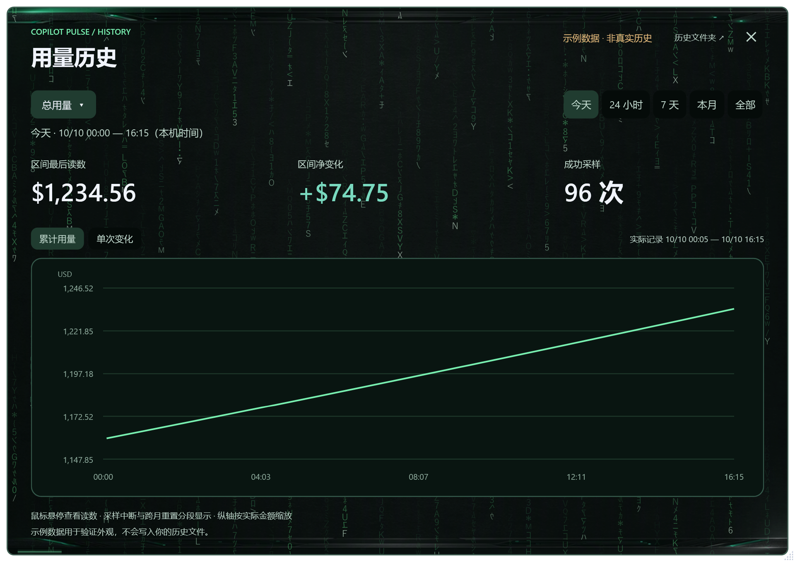

### 累计折线与变化柱状图

**累计用量**：每个点是对应时间读取到的累计金额。选“今天”只是筛出今天的记录，不会把纵轴归零，也不将读数转换为独立的今日账单。

**单次变化**：本次减去上一次连续读数。实际采样间隔受刷新频率与成功读取情况影响，每根柱子不一定代表相同时间长度。采样中断或跨月处不强算增量。

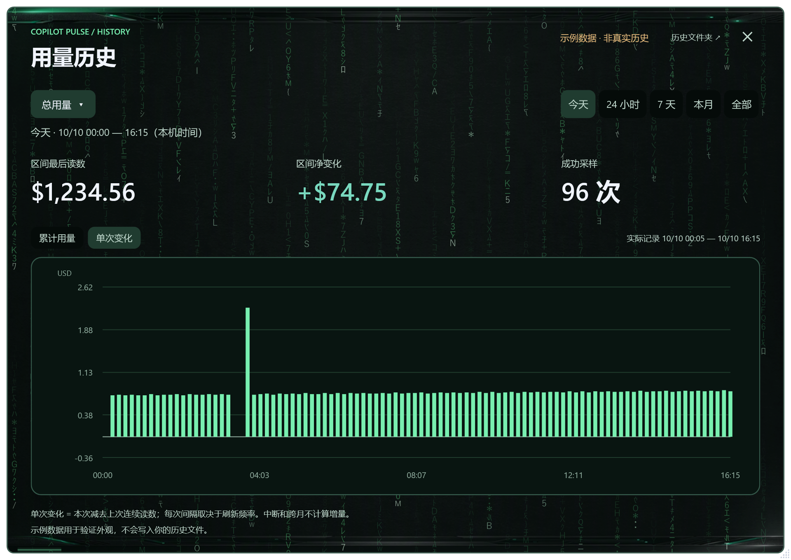

左上角可切换总用量与某个企业。悬停图表查看时间、金额，以及适用时的前后变化和采样间隔。

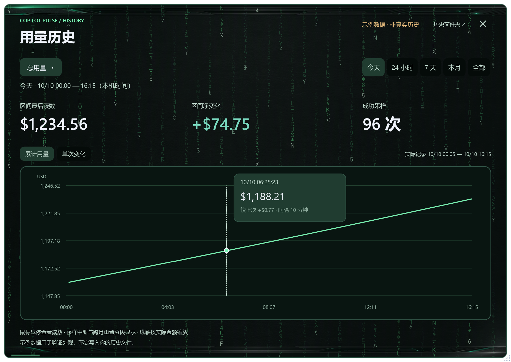

### 三个数字怎么看

| 指标 | 定义 |
| --- | --- |
| 区间最后读数 | 范围内最后的累计金额，不是这段时间的新增金额。 |
| 区间净变化 | 范围内最后读数减去第一读数，要求可比较。 |
| 成功采样 | 所选范围与序列中的有效记录数量，不是点击刷新次数。 |

例如第一笔 `$100.00`、最后一笔 `$112.00`，净变化为 `+$12.00`。如果第一笔在 09:00，这表示从 09:00 到末笔之间观察到的增长，不包括午夜至 09:00 未记录的变化。

配额在每月 1 日 UTC 00:00 重置。中国时区对应每月 1 日 08:00；其他时区按本机时区换算。“今天”仍从本机 00:00 开始。旧记录按真实采样时间重新判定 UTC 月份，不改写原文件。源站金额修正仍可能产生负净变化，保留并提示。

本组截图最后读数 `$1,234.56`，今天净变化 `+$74.75`。负变化也会保留，不强制改成零。

少于两个可比较读数、跨月重置，或有非零金额企业加入、移出而改变合计口径时，净变化显示 `—`，图表下方与悬停提示会说明原因。零金额企业增减不影响比较。曲线在中断和跨月处断开。如果只是中间有采样缺口，而月份与企业集合仍可比较，净变化仍可能按两端计算；它不是所有柱子的简单总和，也不代表缺口中每一笔消费都已记录。

### 主卡片净增长同步

历史选择“今天”“7 天”等区间后，完整与紧凑主卡片同步显示这个范围的**总用量净增长**。新增记录、范围变化和本机时间推进一起刷新。

选择单个企业只影响详细图表；主卡片这行始终按总用量计算。区间和图表模式会保存，重启后继续使用。

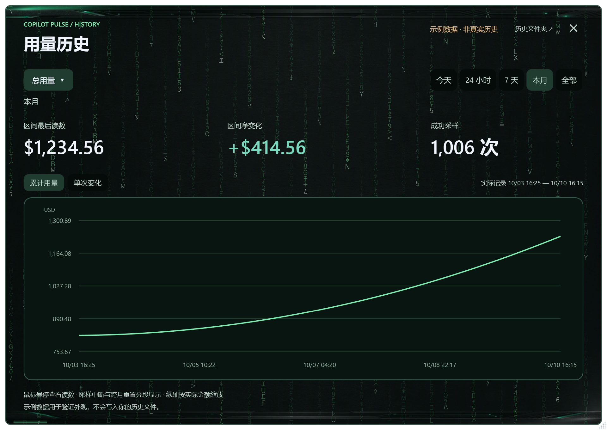

### 记录点与独立增量图表（v1.12.0）

主界面点击 **增加记录点**，按钮变为 **删除记录点**。历史趋势下方出现独立的 **记录区间增量** 卡片，点击打开专属窗口，支持总用量 / 单个账户、累计增量 / 单次采样变化。普通历史区间切换不会改变此计量起点。

点击时记录实际时间，并立即尝试刷新；首个成功读数作为零基线，不会用点击前的缓存回填。暂无有效读数时显示 `—`。成功采样、起点在重启及升级后保留。删除记录点保留已采历史。

设置中也可以输入本机时间 `YYYY-MM-DD HH:mm` 自定义起点，按 Windows 时区保存为 UTC。跨 UTC 配额月份时累加各月实际观测变化；缺整月或账户口径不可比会显示原因，不推算漏采用量。

### 用来观察单次任务的花费

“记录区间增量”适合观察一次代码生成、排查或其他 Copilot 任务前后的用量变化：

1. 任务开始前点击 **增加记录点**。
2. **等首个成功采样建立零基线后，再开始任务**。
3. 任务结束后，等待源页面反映新增用量，并让组件成功刷新。
4. 查看记录区间增量，点击卡片查看累计曲线或单次采样变化。需要重新观察时，删除记录点后再添加；原有历史保留。

这是源页面在所记录时间段内的 **INTERNAL USD 用量变化**。源页面可能延迟更新；同一期间其他任务或账户的消费也可能计入，应尽量避免并行用量，必要时选择对应账户查看。它不能精确归因到某次 API 请求，也不是单任务账单。未采集时段不会补造记录。

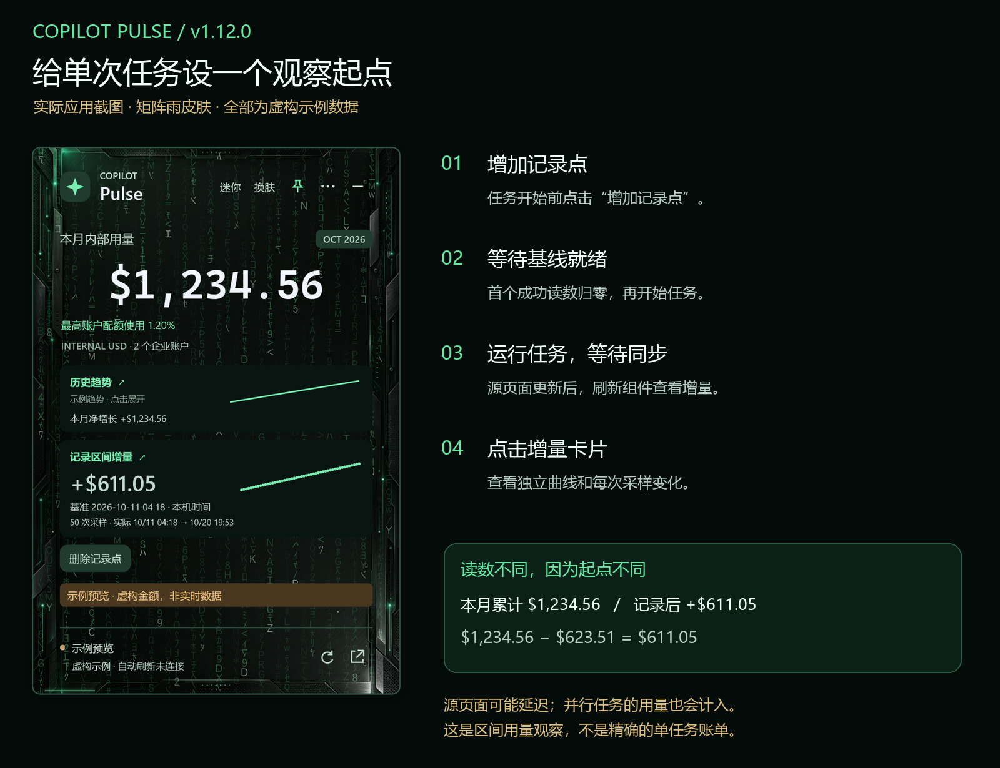

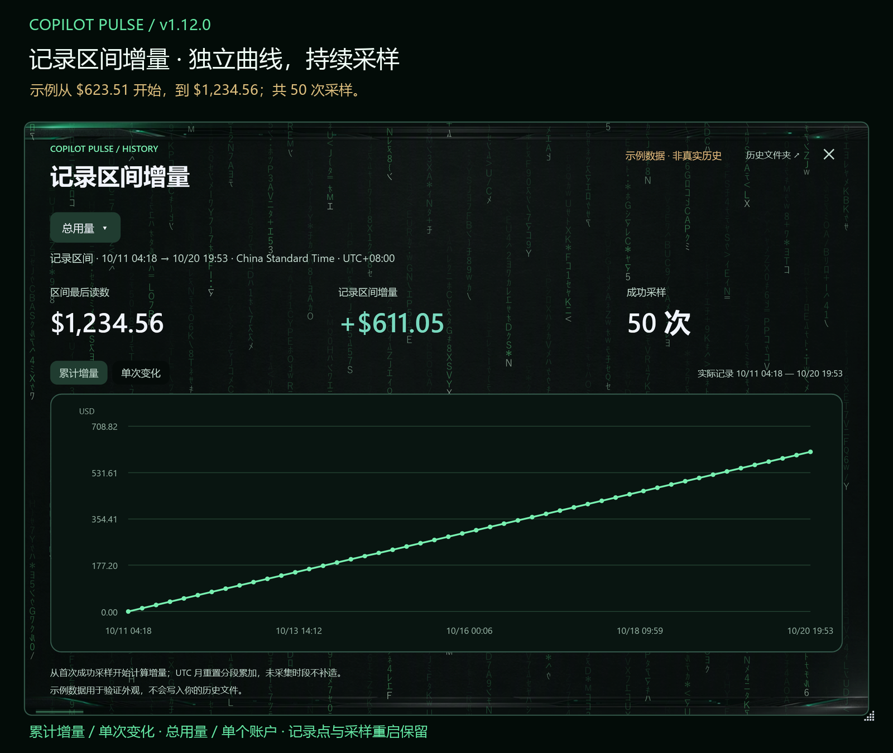

示例本月累计 **$1,234.56**，记录点首个读数 **$623.51**，记录后增量 **+$611.05**，共 50 次采样。这个示例覆盖多天，用于展示计算口径，不代表一次真实任务的花费。

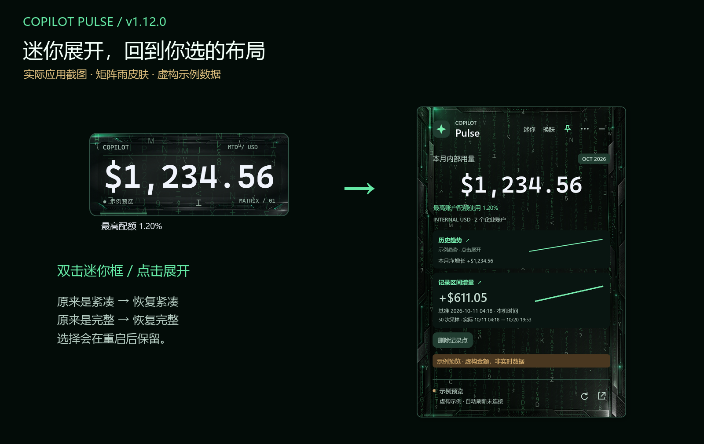

## 7. 换肤与自定义背景

点击“换肤”或右键菜单进入外观窗口。选择即生效，主组件与历史窗口同步变化，无需重启。

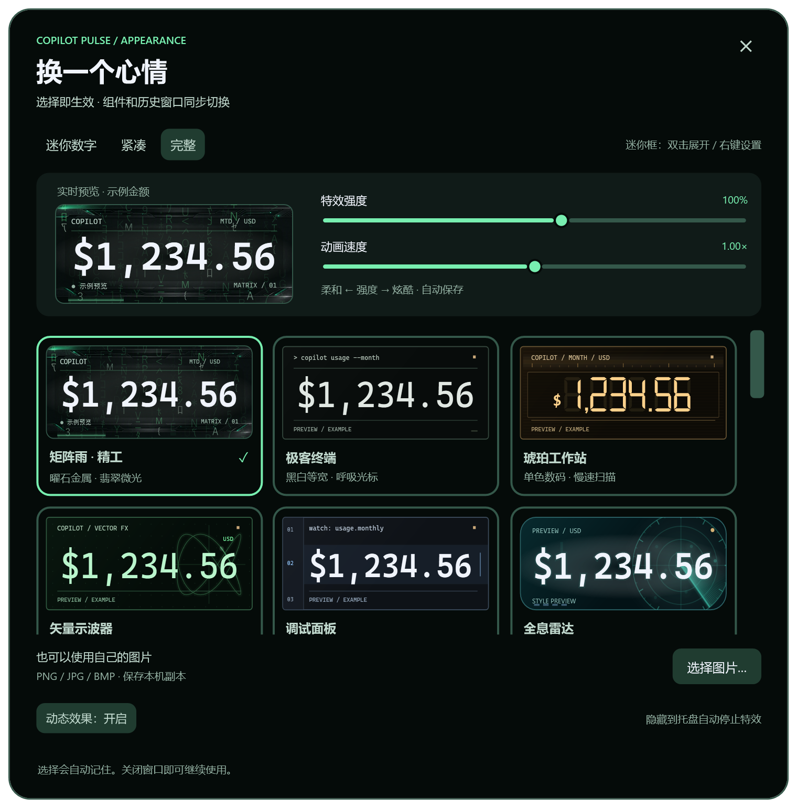

### 22 套内置皮肤

| 风格 | 皮肤 |
| --- | --- |
| 代码与终端 | 矩阵雨·精工、极客终端、绿磷终端、调试面板。 |
| 仪表与硬件 | 掌上液晶、琥珀工作站、琥珀辉光、矢量示波器、全息雷达、机甲 HUD。 |
| 霓虹与空间 | 霓虹协议、落日合成波、星际穿梭、等离子流、极光玻璃。 |
| 复古与简洁 | 像素街机、电子墨水、深海蓝、曜石黑、松林绿、暮光紫。 |
| 插画背景 | 巴依老爷。 |

另有“自定义图片”，选择器共 23 个入口。不同皮肤有字符雨、扫描、辉光、雷达等表现；电子墨水适合静态显示。截图只展示一帧。

### 动画设置

- 特效强度：35%–150%，从柔和到强烈。
- 动画速度：0.50×–1.50×，调整运动节奏。
- 减少动态效果 / 动态效果开关：停止动画；系统动画设置也会影响效果。

设置自动保存，收起到托盘会停止特效。

### 导入自己的背景

1. 点击“选择图片…”。
2. 选择本机 PNG、JPG/JPEG 或 BMP，不超过 25 MB；过大尺寸或无法解析的文件会被拒绝。
3. 调整遮罩深浅和裁切焦点，使字清晰、主体位置合适。
4. 关闭窗口继续使用。应用保留一份受管理的本机图片副本。

图片不会作为运行时请求发送给图像生成服务。缺失或无法读取时回退到可用外观。分享图片前确认使用权和内容是否适合分享。

## 8. 保存备份升级与分享

### 本机文件位置

历史窗口“历史文件夹”可打开记录位置。所有用量、设置和自定义背景的共同目录：

```text
%USERPROFILE%\Documents\Codex\CopilotPulse-data
```

把路径粘贴到资源管理器地址栏即可打开。各 Windows 用户有自己的目录。

| 文件 / 目录 | 内容 |
| --- | --- |
| `history\YYYY-MM.jsonl` | 按月记录时间、月份、总金额、企业名称/登录名、企业金额和采样节奏等。 |
| `consumption.json` | 最近成功读取的缓存。 |
| `preferences.json` | 模式、皮肤、刷新间隔、历史范围和图片设置。 |
| `connection.json` | 连接状态、检查时间与是否有数据。 |
| `skins\` | 自定义背景副本。 |
| `migration.json` / `migration-backups\` | 旧目录迁移状态与适用时的备份。 |
| `errors.log` | 如生成，用于辅助诊断的错误记录。 |

用量文件**未额外加密**，可能含企业名称和登录名。应用不主动向额外服务上传这些记录；Windows 文件同步、备份或企业终端管理可能按自己的配置处理目录。请按组织要求保存。

WebView2 登录会话另行管理，常规桌面运行位置为 `%LOCALAPPDATA%\CopilotPulse\WebView2`，可能受启动环境影响。不要复制这份登录目录给其他人。

### 备份与升级

1. 先从托盘完全退出，避免复制过程中继续写记录。
2. 将 `CopilotPulse-data` 复制到符合组织要求的备份位置。
3. 恢复时先备份当前目录，再恢复自己的记录与设置。
4. 重启后用“月份 ▾”选择已有月份确认历史；换用户或路径后，可重新导入背景。

升级与卸载保留历史和设置。旧目录会尝试合并到共同目录，迁移保留原记录。不要靠清空历史来解决登录问题。

### 分享给同事

分享 Release 安装包和本文档即可，对方登录自己的 corp 账户，仍需满足源站、设备与登录策略，不能保证每台机器静默 SSO。

不要分享自己的数据目录、WebView2 会话、真实截图或整个已运行目录。可分享个人公开仓库的 Releases 安装包链接；每位使用者仍需具有内部用量网页的访问权限。

## 9. 常见问题

| 问题 | 原因与操作 |
| --- | --- |
| 首次启动没有金额 | 在“Windows 账户登录 / 数据源”完成验证，确认有站点权限。 |
| corp 账户仍要求登录 | SSO 受设备、主账户、旧会话、MFA 和条件访问影响，按窗口要求验证。 |
| 浏览器正常组件失败 | 会话独立，需要在组件中登录。浏览器打开主要用于核对。 |
| 突然刷不到数据 | 检查网络、源页面和组件会话，再手动刷新；源页面正常但仍失败可能是布局变化。 |
| 频繁刷新金额不变 | 没有新增消费或网站未更新；组件不能加快站点统计。 |
| 显示旧金额 | 失败时保留并标记缓存，查看底部状态。 |
| 今天只显示部分时间 | 启动前、暂停、退出、休眠和失败时段不会回补。 |
| 图表断线 | 采样中断或跨月重置，避免把不同阶段错误连起来。 |
| 净变化是 `—` | 检查是否有两个可比较记录；跨月和非零金额企业加入、移出也会影响比较，界面会显示原因。 |
| 跨月区间没有净增长 | 月累计在 UTC 00:00 重置；用“月份 ▾”单独选月份，避免不同月份的首末相减。 |
| 主卡片与企业净变化不同 | 主卡片按总用量，企业图按单个企业，对象不同。 |
| 重启看不到历史 | 用“月份 ▾”选择已有月份，打开历史文件夹确认文件，检查用户、权限、磁盘与迁移状态。 |
| 自定义背景不见了 | 检查 `skins` 和设置，必要时重新导入原图。 |
| 动画影响专注 | 降低强度 / 速度，关闭动效或收起到托盘。 |
| 最小化后找不到 | 在托盘隐藏图标中找到 Copilot Pulse，双击恢复。 |

报告问题时说明版本、Windows 版本、时间、状态和复现步骤。先遮挡截图中的真实账户、企业和金额，不要附带 Cookie、令牌或登录目录。

## 10. 功能边界与参考

当前版本是桌面悬浮组件与托盘入口，没有嵌入开始按钮所在任务栏的数字栏位，支持阈值警告和中英文设置，暂不支持免打扰时段或 CSV 导出。退出后不采集。

这是非官方工具。介绍结构参考 [mcaps-microsoft/copilot-usage-monitor](https://github.com/mcaps-microsoft/copilot-usage-monitor)，功能、SSO、安装与存储说明按 Copilot Pulse 实际实现编写。构建方法见 [项目首页](../README.md)，素材见 [矩阵背景](../Assets/MATRIX-ART.md) 与 [当前图标](../Assets/SELECTED-DESKTOP-ICON.md)。

## v1.10.0：更新、字体和阈值进度

打开主卡片 ⋯ → 设置，选择“数字字体”。默认跟随皮肤，保留液晶七段、像素和辉光管；其他字体覆盖数字外观，背景动画继续保留。选项包括 Segoe UI、Bahnschrift、Consolas、Cascadia Mono、Georgia、Impact，缺少字体时 Windows 会回退。金额会随容器缩放，避免长数字溢出。

启用金额警告后，主金额下面显示本月合计相对金额阈值的比例，例如 $600 / $1,000 = 60%。超过阈值允许显示大于 100%。这表示自定义警告线进度。配额模式显示最高单账户的 Cost / Monthly limit；不会把不同账户配额简单相加。页面没有数字限额时显示不可计算。提示在完整、紧凑与迷你模式都会刷新，达到警告线后仍另有警告和通知。

设置 → 在线更新，默认选择个人公开仓库。点击“一键更新并重启”，应用自动检查最新正式版本、下载、校验 SHA256、静默安装并重新启动，无需手动运行安装器。也可单独检查更新；已是最新版时不会重新下载。版本号来自当前运行的程序集，安装后再次核对目标版本。

历史、登录和偏好设置存放在安装目录外，会保留；客户端需要短暂重启，Windows 不需要重启。EMU 私有镜像需要已登录且有访问权限的 GitHub CLI 账户，也可用浏览器下载。应用每小时检查；未打开提醒满48小时自动更新，打开提醒会取消该版本的无人值守安装。检查或下载失败不会关闭客户端，可点击一键更新重试。

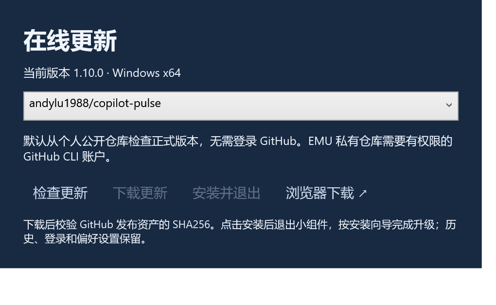

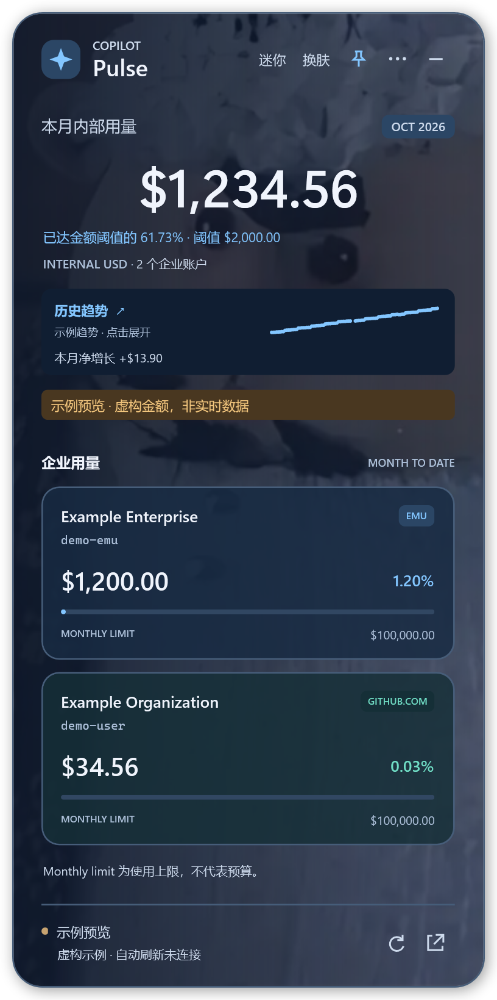
