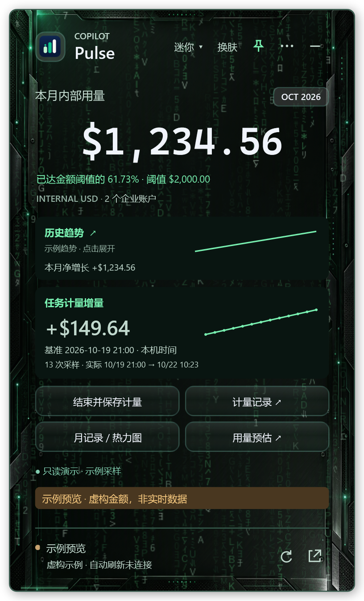
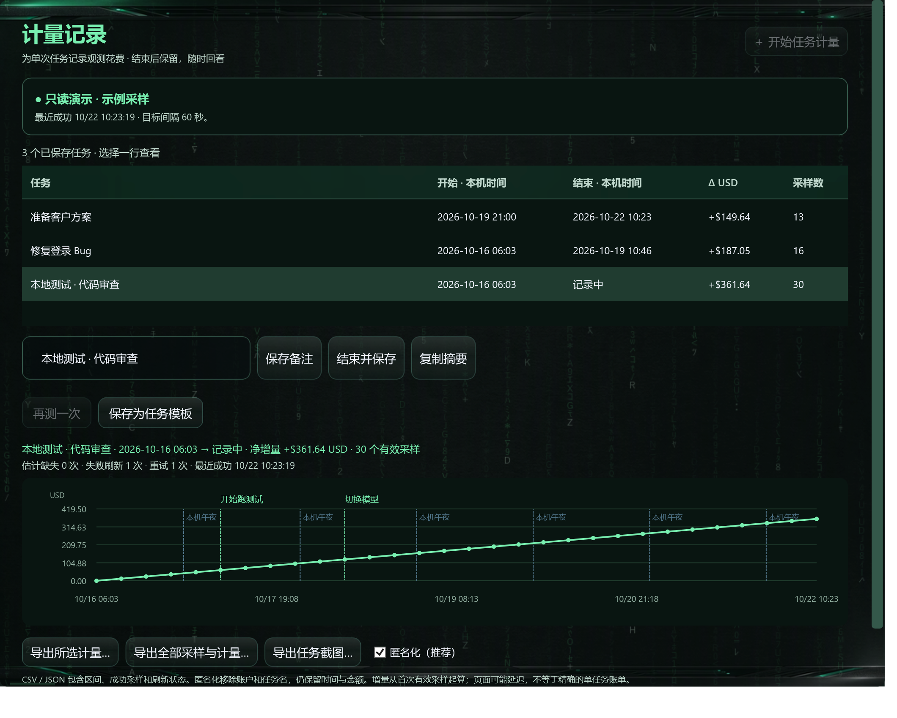
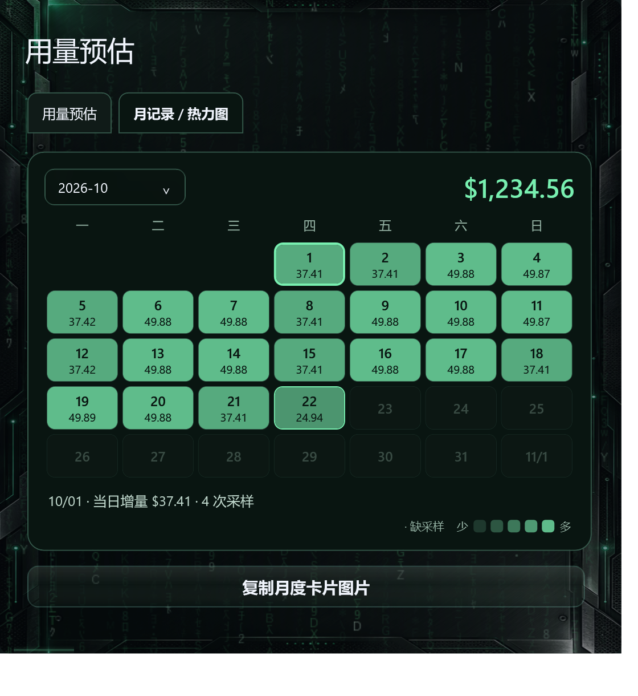
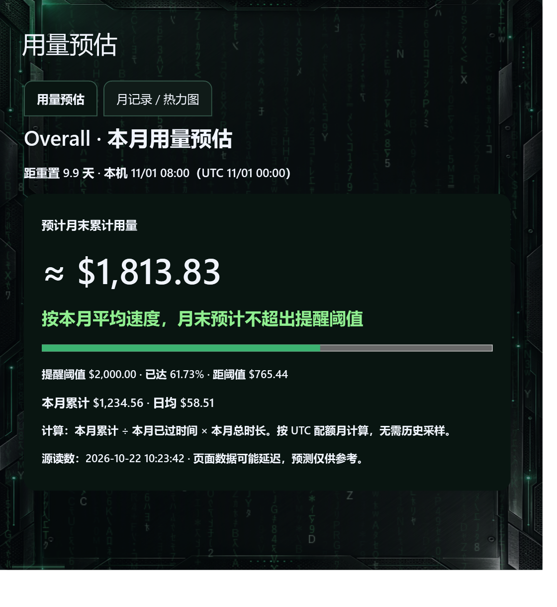
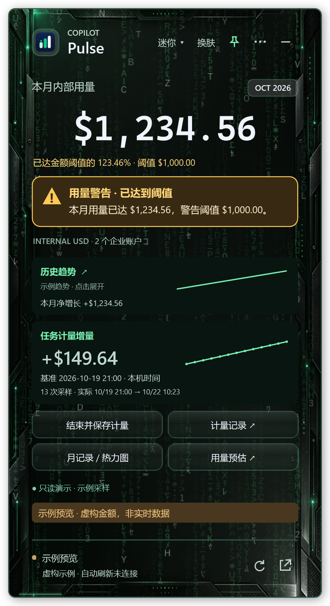
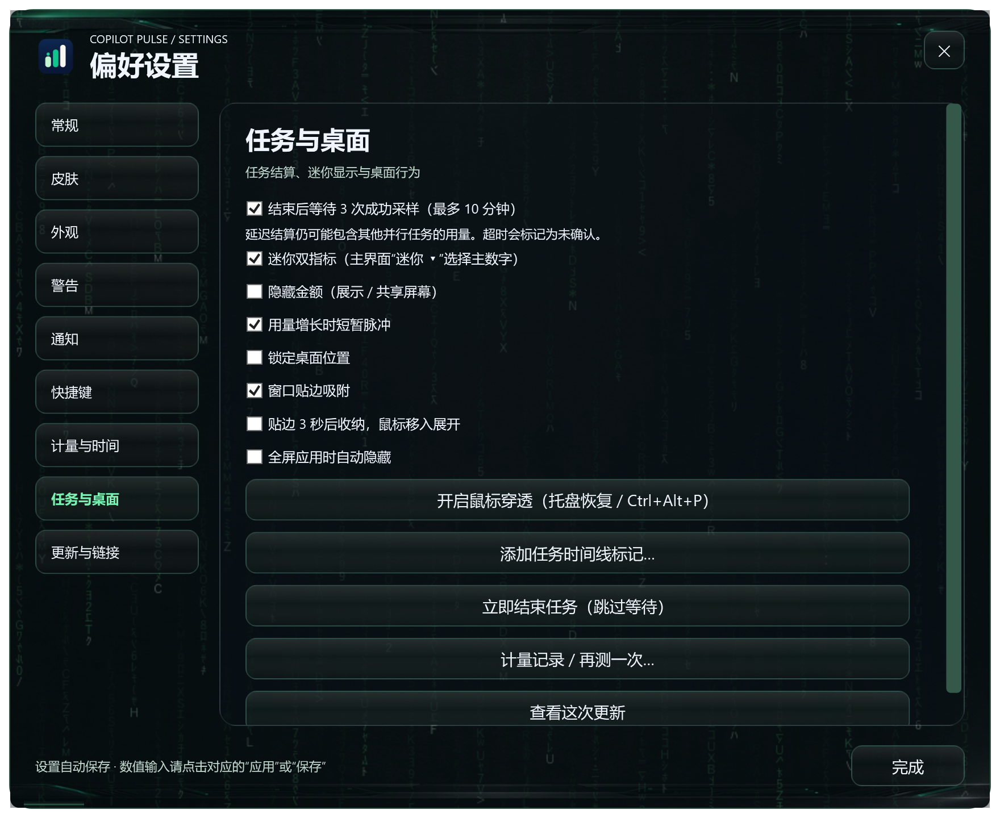
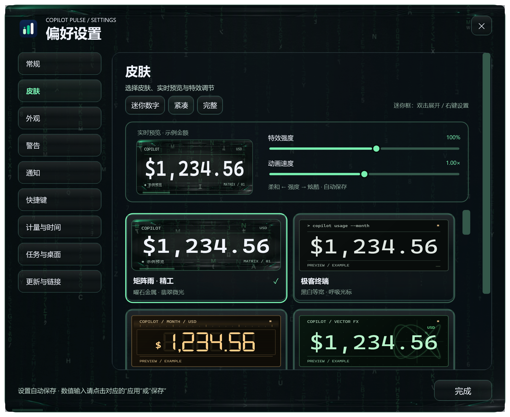
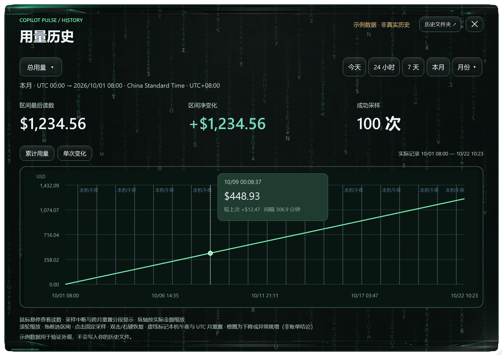

# 使用指南 · v1.14.0

[完整项目介绍](../README.md) · [版本变更](UPDATES-SINCE-v1.12.0.md)

## 安装、登录与数据 / Installation, sign-in and data

1. 当前正式版为 [v1.14.0](https://github.com/andylu1988/copilot-pulse/releases/tag/v1.14.0)，Windows 10 1809+ / Windows 11 x64，需 WebView2。
2. 启动后点击 **连接 Microsoft 账户**，使用自己的、有源站权限的公司账户完成官方登录，等待首个成功同步。
3. WebView2 尝试 Windows 公司账户 SSO，不保证复用浏览器会话或 PRT。安装包不含作者账号、会话或密钥。
4. 正式版支持每小时检查、48 小时提醒期及下载校验后安装并重启客户端；Windows 无需重启。v1.14.0 正式版已启用在线更新。

上图中间栏是操作说明，不是登录页截图。每位用户使用自己的登录会话；安装器尚未做发布者代码签名。

本机数据目录为 `%USERPROFILE%\Documents\Codex\CopilotPulse-data`：`history/yyyy-MM.jsonl` 为历史、`sampling/yyyy-MM.jsonl` 为采样事件、`tasks.json` 为任务、`preferences.json` 为设置、`reminders.json` 为提醒状态。升级和卸载保留数据，备份前正常退出应用。历史从采样开始积累，未运行期间的数据无法回补。

这是个人开发的非官方辅助工具，金额为源页面 INTERNAL USD，请以源站为准。本地文件未额外加密；匿名任务导出仍含时间、金额和任务 ID，分享前应检查。诊断报告排除账户、金额、凭据、Cookie 和网页正文。

Install the stable x64 release, connect your own authorized corporate account, and wait for synchronization. WebView2 attempts Windows-account SSO; browser-session/PRT reuse is not guaranteed. No author credentials are included. Stable clients support hourly update checks and download / checksum / install / app restart; unopened notices trigger unattended installation after 48 hours. v1.14.0 supports in-app updates. Local unencrypted history, task and sampling files survive upgrades/uninstall; missing data cannot be backfilled. Anonymous task exports still contain timestamps, amounts and IDs. This is an unofficial observation tool; source readings remain authoritative.

## v1.14.0：任务观察与桌面体验

**v1.14.0 已发布。** 可从 GitHub 下载 Windows x64 安装包，或在客户端选择“在线更新”完成下载、校验、安装和自动重启。以下截图使用矩阵皮肤与隔离的虚构数据。

### 一次任务，从开始到延迟结算

1. 点击 **开始任务计量**，填写任务名；可选择常用模板，或在计量记录中选择 **再测一次** 沿用备注。
2. 等待首个成功采样建立零基线后再工作。计量期间可以添加“开始跑测试”“切换模型”等时间线标记。
3. 点击 **结束并保存计量** 后，默认等待 3 次新的成功采样，最长 10 分钟，以观察源页面延迟更新。可以立即结束、跳过等待；超时结果标为未确认。
4. 在 **计量记录** 回看任务名、起止时间、增量、采样次数、失败与重试，复制摘要或导出 CSV / JSON / PNG。

适合测试观察单次 Bug 修复、代码审查、生成图片或方案准备期间的花费。增量包含源页面延迟及同期并行用量，不能当作精确单任务账单；时间线标记也不能自动识别模型花费。

### 迷你双指标，主副数字独立选

主界面 **迷你 ▾** 或迷你面板右键菜单可选择主指标，开启双指标并选择副指标。可显示本月总用量、今天、滚动 24 小时、7 天、本月或已保存月份的观测增量；有正在计量的任务时才可选任务增量。

**不需要开启任务计量，也能同时显示“本月累计＋今天 / 七天增量”。** 任务结束后不再显示不可用的任务数字；尚无足够采样时显示等待状态。退出迷你恢复此前的紧凑或完整布局，选择保存在本机。

### 月记录 / 热力图：每天花了多少

主界面 **月记录 / 热力图** 直接打开用量预估窗口中的对应页，也可从三点菜单进入。选择月份，色阶展示每日观测增量；每格显示金额，点击某天查看日期、精确增量和采样数。缺采样与真实零增长分别显示，今天与选中日期有独立高亮。

月度归档从已有采样整理月末累计、覆盖情况、活跃日期和保存的任务，可复制月度卡片图片。月度累计来自源页面；每日金额是已有采样之间的观测变化，缺失区间不会补造，因此每日金额之和不保证等于月度累计。

### 用量预估与提醒

预估突出 **预计月末累计量 → 是否预计达到目标 → 进度条 → 统计依据**。仅按 Overall 本月累计及 UTC 配额月已过时长计算：本月累计 ÷ 已过时长 × 当月总时长。优先使用设置的金额提醒阈值；它是个人目标，不会修改服务额度。没有可用金额目标或完整数值额度时，不推断是否耗尽；过旧、上月和未来读数暂停预估。

金额阈值进度始终可见。示例 $1,234.56 / $2,000 = 61.73%；阈值为 $1,000 时为 123.46%，超出 $234.56。应用内警告在通知静音时仍显示。支持提醒冷却、免打扰、完全静默、重置前提醒、采样中断与恢复通知；Windows 通知送达受系统设置影响。

### 隐私、动画和桌面收纳

| 功能 | 操作与行为 |
| --- | --- |
| 隐藏金额 | 手动开启共享屏幕保护，主副金额同步隐藏，保留进度和状态；含金额的详情入口会要求先关闭保护。不会自动检测屏幕共享。 |
| 用量脉冲 | 读数增长时短暂强调数字与边框；可关闭，持续动画按已设置帧率运行。 |
| 桌面收纳 | 贴边吸附、贴边 3 秒后收起、鼠标移入展开、全屏应用时自动隐藏，均可选。 |
| 桌面锁定 / 穿透 | 固定位置避免误拖；鼠标穿透可通过托盘或 Ctrl+Alt+P 恢复。 |
| 更新说明卡 | “这次改了什么”展示主要变化并直达相关设置。 |

### 设置、皮肤与图表

**⋯ → 设置 → 任务与桌面** 集中管理新增选项；主界面换肤仍直达设置的皮肤页。支持中英文、采样频率、数字字体、动画帧率与强度、自定义背景。关闭与完成操作固定显示；关于、在线更新、命名、记录窗口同步当前皮肤。矩阵动画和玻璃背景复用绘制结果；历史与计量曲线保持实色背景方便读图。

历史趋势支持今天、24 小时、7 天、本月和指定月份，以及悬停读值、固定提示、滚轮缩放、框选、重置和变化标记。今天从 Windows 本机午夜开始；配额月按每月 1 日 UTC 00:00 重置，并换算系统时区显示。缺失起点不会假定为零，刷新保留缩放。

可选全局快捷键 Ctrl+Alt+T / M / R / H 用于任务、迷你、刷新和最近任务；托盘支持暂停采样、恢复和悬停查看用量。**⋯ → 连接诊断** 独立检查会话、时区、采样、存储及快捷键，并导出诊断报告。
