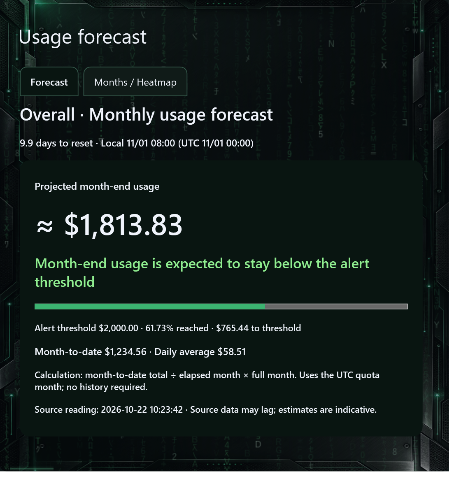
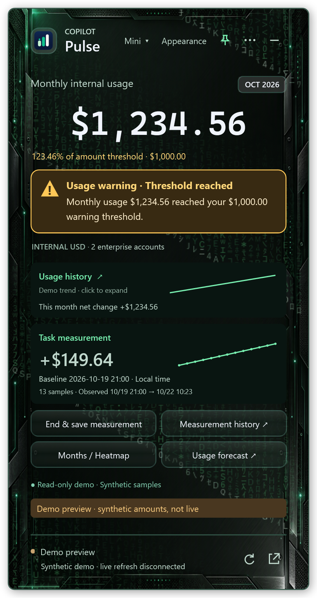

# 用量预估与月记录 / Usage forecast and monthly records

### 月记录 / 热力图：每天花了多少

主界面 **月记录 / 热力图** 直接打开用量预估窗口中的对应页，也可从三点菜单进入。选择月份，色阶展示每日观测增量；每格显示金额，点击某天查看日期、精确增量和采样数。缺采样与真实零增长分别显示，今天与选中日期有独立高亮。

月度归档从已有采样整理月末累计、覆盖情况、活跃日期和保存的任务，可复制月度卡片图片。月度累计来自源页面；每日金额是已有采样之间的观测变化，缺失区间不会补造，因此每日金额之和不保证等于月度累计。

### 用量预估与提醒

预估突出 **预计月末累计量 → 是否预计达到目标 → 进度条 → 统计依据**。仅按 Overall 本月累计及 UTC 配额月已过时长计算：本月累计 ÷ 已过时长 × 当月总时长。优先使用设置的金额提醒阈值；它是个人目标，不会修改服务额度。没有可用金额目标或完整数值额度时，不推断是否耗尽；过旧、上月和未来读数暂停预估。

金额阈值进度始终可见。示例 $1,234.56 / $2,000 = 61.73%；阈值为 $1,000 时为 123.46%，超出 $234.56。应用内警告在通知静音时仍显示。支持提醒冷却、免打扰、完全静默、重置前提醒、采样中断与恢复通知；Windows 通知送达受系统设置影响。

### Daily heatmap and monthly archive cards

The main **Monthly records / Heatmap** action opens the corresponding tab inside Usage forecast. Choose a month; each cell shows daily observed change. Click a date for its exact amount and sample count. Missing samples are distinct from zero; today and the selection are highlighted. Monthly cards summarize available month-end usage, coverage, busiest day and saved tasks and can be copied as an image. Daily observed changes may not sum to the source monthly total because gaps are not fabricated.

### Overall forecast and alerts

The compact forecast prioritizes projected month-end total, target risk, progress and concise statistics. It uses Overall month-to-date usage ÷ elapsed UTC quota-month time × total month time. A configured amount alert target takes priority and does not change the service quota. Without an amount target or complete numeric source caps, depletion cannot be assessed. Stale, prior-month and future readings pause forecasting.

Amount threshold progress remains visible even with muted notifications. Fictional usage of $1,234.56 is 61.73% of $2,000; against $1,000 it is 123.46%, exceeding the target by $234.56. Cooldowns, quiet hours, silent mode, reset and sampling interruption/recovery alerts are configurable. Windows controls notification delivery.

